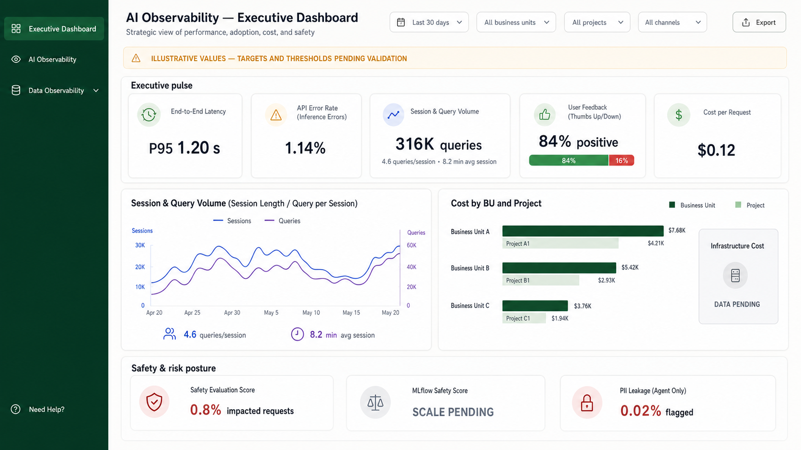

# Executive Dashboard Concept 01



## Design idea

The dashboard is organized around the order in which an executive is likely to make decisions:

1. **Executive pulse** — one-row visibility into performance, reliability, adoption, feedback, and unit cost.
2. **Adoption movement** — a single trend that combines sessions and queries, with query-per-session and session-length context.
3. **Cost allocation** — business-unit and project roll-up beside infrastructure cost, so total direction and ownership stay connected.
4. **Safety and risk posture** — the three documented safety/security indicators are grouped into one exception-oriented strip.

This keeps the familiar green navigation, compact controls, white-card system, and scanability seen in the supplied screenshots. It deliberately removes unsupported executive metrics present in the earlier concepts, including application counts, composite health, quality, governance, recommendations, token usage, model footprint, and portfolio matrices.

## Organizational hierarchy and filters

### Business unit, project, and application

The documented fields imply the hierarchy **Business Unit → Project / use case → Application**. A business unit is the organizational owner, a project is a narrower initiative or use case within that organization, and a project may contain multiple applications. The documentation separately discusses `Business Domain`; whether that is equivalent to Business Unit remains an open terminology decision.

### All Channels

`All Channels` means that no request-entry channel filter is applied. Documented channel examples are `web`, `teams`, `mobile`, and `api`. Selecting one should filter only telemetry that can be attributed to that channel. It should remain a global filter only if channel is available or reliably correlated across every affected KPI; otherwise it should be limited to adoption/session analysis.

### All Projects

`All Projects` represents every project the user is authorized to view. Selecting a project should globally scope all applicable cards, charts, explanation drawers, investigations, and exports to that project while preserving the other active filters. The project list should be constrained by the selected business unit, or selecting a project should automatically resolve its owning business unit. A metric that cannot support project filtering should show `Data Pending` or `Project breakdown unavailable` rather than retain a portfolio-wide value.

## Questions for the client

### Hierarchy, filters, and access

- What is the authoritative hierarchy and terminology for Business Domain, Business Unit, Department, Project, and Application?
- What are the approved business units, projects, and application-to-project mappings? Can a project belong to more than one business unit?
- Are `business_unit`, `project_name`, and `channel` recorded on, or reliably correlated to, latency, API-error, feedback, cost, and safety events?
- Should Business Unit, Project, and Channel filter every supported executive card and drawer? What should a KPI show when only part of the selected scope can be attributed?
- Should selecting a project automatically resolve its owning business unit, and should the resulting scope persist in drawers, exports, shared links, and browser navigation?
- Which business units and projects may each executive view, and are minimum cohort sizes or suppression rules required for aggregated feedback?

### API Error Rate

- What exactly belongs in the error numerator: `response_status = error`, timeouts, content-filtered responses, selected HTTP status codes, or another rule?
- What is the denominator and event grain for total requests, and how should retries, duplicate events, cancellations, and agent sub-calls be handled?
- What is the approved `error_code (API)` taxonomy, and which codes may be grouped into executive-level categories?
- Is a common event timestamp available for API outcomes so the drawer can support trends and equivalent previous-period comparisons?
- Should raw `error_message (API)` values remain excluded from the Executive persona, with only approved aggregate categories displayed?

### User Feedback

- Is `user_feedback_score` binary (`1 = thumbs up`, `0 = thumbs down`) or a rating scale where positive means `>= 3`?
- What constitutes one feedback event when the same request or correlation receives multiple updates: first response, latest response, or every event?
- Is a feedback-event timestamp available for trends and equivalent previous-period comparisons?
- Can feedback be reliably correlated to the eligible request population so that a feedback response rate can be calculated?
- Should the dashboard show distinct feedback users and feedback events per user, and what privacy or minimum-cohort rules apply?
- Can feedback be attributed to business unit, project, application, and channel without exposing user identities?

### Comparisons and attention states

- What comparison window, timezone, precision, and rounding rules should all executive detail drawers use?
- What approved targets or thresholds determine neutral, needs-attention, and critical states for latency, API Error Rate, and User Feedback?

## Confirmed facts

- The Executive Dashboard contains ten documented metric mappings: End-to-End Latency, API Error Rate (Inference Errors), Session & Query Volume, User Feedback, Cost per Request, Cost by BU and Project, Infrastructure Cost, Safety Evaluation Score, MLflow Safety Score, and PII Leakage (Agent Only).
- End-to-End Latency can be presented as an average or P95 of `response_latency_ms`.
- The latency fields support time-based analysis, and separate cost/adoption mappings contain business-unit, project, or channel fields. Time and attribution fields are not confirmed directly for API Error Rate or User Feedback.
- Infrastructure Cost has no exact generic field-description match.
- The MLflow Safety Score documentation contains a scale conflict: its example uses 4.42/5, while the joined field description says float 0-1.

## Likely interpretations

- Executives need an aggregated, exception-oriented view before application-level detail.
- Repeating the adoption metric as both a summary card and a trend is useful: the card provides the current snapshot, while the chart provides direction and context.
- Cost allocation should stay visible on the first screen because cost by BU/project and infrastructure cost are separate documented executive concerns.

## Assumptions used for the concept

- The 30-day period and BU, project, and channel filters are interaction-design proposals, not confirmed requirements.
- All numeric values are illustrative placeholders. They do not represent validated current data.
- Business Unit A/B/C and Project A1/B1/C1 are generic display labels, not known organizational entities.
- The chart types, grid, comparison behavior, icons, and colors are design proposals.

## Missing evidence before implementation

- Validated current values, aggregation windows, comparison periods, targets, and alert thresholds.
- The authoritative MLflow Safety Score scale and thresholds.
- The Azure Cost Management contract needed for Infrastructure Cost.
- Splunk/API query contracts, refresh cadence, data-freshness behavior, and loading/error/empty states.
- Confirmed filter behavior and executive-detail destinations.
- API error numerator, denominator, event-grain, retry, and error-code grouping rules.
- User-feedback scoring, deduplication, eligible-response denominator, and privacy rules.
- Timestamp and attribution contracts for API Error Rate and User Feedback.

## Final image-generation brief

```text
Use case: ui-mockup
Asset type: polished desktop Executive Dashboard concept image for an AI Observability web application
Primary request: Generate a new original, realistic, implementation-ready one-page dashboard mockup for business executives. It must present exactly the ten documented executive metrics and avoid introducing any additional portfolio, quality, governance, recommendation, health-score, application-count, token, or model metrics.
Input images: Images 1-2 are composition and density references for a portfolio dashboard. Images 3-5 are references for the existing product's green navigation shell, typography, simple cards, filter controls, reliability presentation, and cost presentation. Treat all images as visual references only; do not reproduce their unsupported metrics or exact layout.
Scene/backdrop: full 16:9 landscape desktop application screen, light warm-gray canvas, white cards, thin borders, subtle shadows, ample whitespace.
Style/medium: shippable enterprise product UI, crisp sans-serif typography, restrained and credible, not concept art, not a browser screenshot, no browser chrome.
Composition/framing:
- Narrow dark forest-green left navigation rail, with "Executive Dashboard" selected.
- Main header: "AI Observability — Executive Dashboard" and subtitle "Strategic view of performance, adoption, cost, and safety".
- Top-right controls: "Last 30 days", "All business units", "All projects", "All channels", and "Export".
- Directly below header, a slim pale amber banner reading exactly: "ILLUSTRATIVE VALUES — TARGETS AND THRESHOLDS PENDING VALIDATION".
- Section 1 title "Executive pulse". Five equal KPI cards in one row, using these exact labels and sample values:
  1. "End-to-End Latency" — "P95 1.20 s"
  2. "API Error Rate (Inference Errors)" — "1.14%"
  3. "Session & Query Volume" — "316K queries" and small line "4.6 queries/session • 8.2 min avg session"
  4. "User Feedback (Thumbs Up/Down)" — "84% positive" and small split bar labeled "84% / 16%"
  5. "Cost per Request" — "$0.12"
- Section 2 is a two-column grid. Left large card title "Session & Query Volume (Session Length / Query per Session)" with a clean 30-day dual-line trend chart labeled "Sessions" and "Queries", plus small supporting values "4.6 queries/session" and "8.2 min avg session". Right card title "Cost by BU and Project" with grouped horizontal bars for generic labels "Business Unit A", "Business Unit B", "Business Unit C", each with a smaller nested Project bar, and a compact neutral sub-card labeled "Infrastructure Cost" with value "DATA PENDING".
- Bottom full-width card title "Safety & risk posture". Three clearly separated indicators:
  1. "Safety Evaluation Score" with "0.8% impacted requests"
  2. "MLflow Safety Score" with "SCALE PENDING"
  3. "PII Leakage (Agent Only)" with "0.02% flagged"
Use muted green for favorable movement, amber for attention, red only for risk, indigo for neutral data series. Color must not be the only status cue; include simple icons or text.
Text (verbatim): all labels and values listed above.
Constraints: Keep every required label fully visible and spelled exactly. Use only the ten documented executive metrics. Make the hierarchy readable at a glance, with no tiny dense table. No corporate logo, no trademarks, no watermark, no stock imagery, no extra metrics, no Total Applications, no Healthy/Warning/Critical summary, no Quality, no Governance, no Recommendations, no portfolio matrix.
```

The image was generated with the built-in image-generation mode using five supplied screenshots as visual references.
