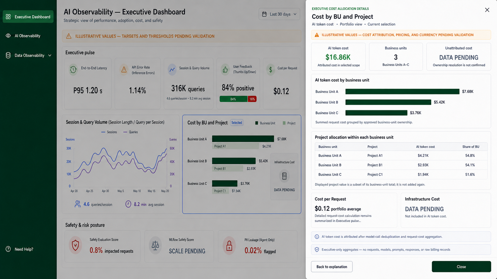

# Executive Dashboard Cost by BU and Project Details

## Design decision

**Cost by BU and Project** is one clickable main-view section. Selecting it
opens the single Executive Cost Allocation drawer shown above and outlines the
whole section. Individual business-unit bars and project bars are not separate
click targets.

The drawer explains portfolio AI token-cost allocation across the displayed
business units and projects. It deliberately replaces the legacy
Business-Unit-A-specific drawer in
[`executive-dashboard-explanation-token-cost-01.png`](executive-dashboard-explanation-token-cost-01.png).

## Confirmed facts

- The metric is attributed **AI token cost**, calculated from eligible request
  costs after model-call deduplication and per-request cost aggregation.
- Business-unit cost is the sum of attributed request cost grouped by business
  unit; project cost is the sum grouped by business unit and project.
- A project cost is a subset of its owning business unit's cost. It must not be
  added to the business-unit amount as a separate category.
- The existing concept values are illustrative: Business Unit A `$7.68K`,
  Business Unit B `$5.42K`, Business Unit C `$3.76K`; Project A1 `$4.21K`,
  Project B1 `$2.93K`, and Project C1 `$1.94K`.
- Infrastructure Cost has no confirmed calculation contract. It remains
  separate from AI token cost and is shown as `DATA PENDING`.

## Likely interpretation

The drawer answers: *how is the included AI token cost allocated across the
portfolio's business units and their project subsets?* It is not a
business-unit investigation, a model-cost analysis, or a total-cost-of-
ownership view.

## Assumptions used in the mockup

- Costs are summed, not averaged, for the business-unit and project allocation
  view; the portfolio average Cost per Request is shown only as contextual
  information.
- Business units are in descending AI token-cost order.
- Each request has one owning business unit and project unless an approved
  shared-cost allocation rule applies.
- The `$` symbol represents USD for the concept only.
- All values are illustrative, including the three displayed project shares.

## Missing evidence and open decisions

- The authoritative business-unit hierarchy and normalization of
  `business_unit`, `l1_bu`, `l2_bu`, and `project_name`.
- The ownership and allocation rule for shared, cross-project, missing, or
  conflicting attribution.
- The approved pricing source, currency, effective-date, retry, cached-token,
  and partial-telemetry rules.
- Whether a shown project is the top project, a selected project, or an
  approved representative; the current design labels it only as a displayed
  project subset.
- The required no-data, loading, stale-data, and API-error states.

## Retired interaction

The old Business Unit A drawer is retained as a historical visual reference,
but its selected-bar interaction, unit-specific trend, change, coverage,
refresh, and operational-investigation action are not part of this design.
Those elements require evidence and an authorized interaction decision before
they could be reinstated.

## Final image-generation prompt

Use case: `ui-mockup`  
Asset type: Executive Dashboard section-level cost-allocation drawer

Create a 16:9 Executive Dashboard mockup with the full **Cost by BU and
Project** section selected and a wide right-side drawer titled **Cost by BU
and Project**. Include a validation banner; a portfolio AI token-cost summary;
three descending business-unit bars; a table showing each displayed project as
a subset of its parent business unit; a portfolio-average Cost per Request
context card; and a separate Infrastructure Cost `DATA PENDING` card.

Show executive-only aggregates. Do not select individual bars, show trends,
period changes, coverage, freshness, request counts, model/application
rankings, raw billing records, prompts, responses, user identifiers, or an
operational-investigation action. Never use **Total Cost** and never include
Infrastructure Cost in AI token cost.
