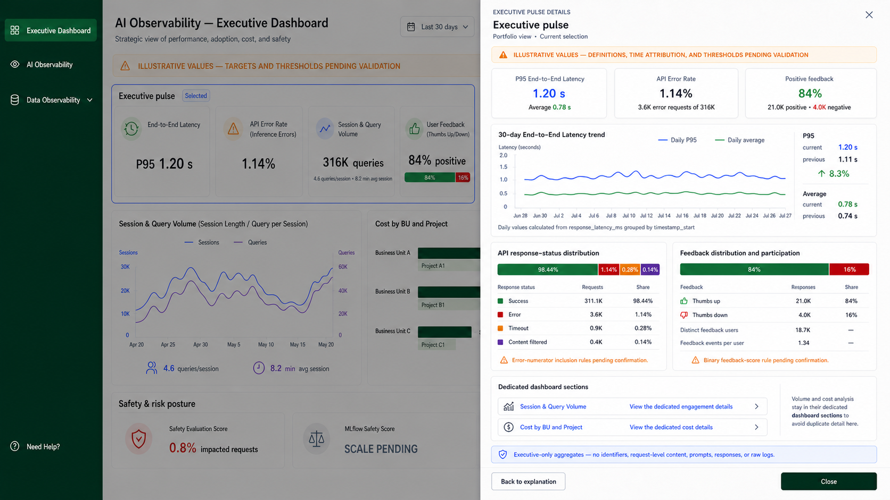

# Executive Dashboard Pulse Details

## Design decision

The **Executive pulse** is now one clickable section. Selecting it opens the
single **Executive pulse** right-side drawer shown above. It consolidates the
executive-level details previously represented by the End-to-End Latency, API
Error Rate, and User Feedback drawers.

The selected section is outlined as a whole; no individual pulse card is
selected. This matches the section-level interaction model adopted for the
other dashboards.

Session & Query Volume and Cost per Request remain visible in the pulse as
summary signals, but they are deliberately not expanded in this drawer:

| Pulse signal | Detail destination | Reason |
|---|---|---|
| Session & Query Volume | The existing **Session & Query Volume** chart and its [Executive Engagement Details drawer](executive-dashboard-session-query-details.md) | The chart already owns the time-series and engagement drill-down. |
| Cost per Request | The existing **Cost by BU and Project** section and its [Cost Allocation drawer](executive-dashboard-cost-by-bu-project-details.md) | The cost section owns cost analysis and attribution. |

The drawer provides link-style handoffs to those two dedicated sections rather
than duplicating a second trend, cost breakdown, or competing calculation.

## Confirmed facts

- End-to-End Latency supports period P95, average latency, previous-period
  P95, a daily P95/average trend, and recent daily comparison from
  `response_latency_ms` with timestamp support. Its business-unit and project
  attribution remain unsupported.
- API Error Rate supports the portfolio rate, error-request count, total
  request count, and aggregate response-status distribution. The treatment of
  timeouts and content-filtered responses in the numerator is unconfirmed.
- User Feedback supports aggregate positive/negative counts and percentages,
  distinct pseudonymized feedback users, and feedback events per user. The
  mapped feedback-score semantics conflict and require validation.
- No supplied evidence supports an Executive previous-period API-error or
  feedback comparison, so neither is shown.
- Executive drawers remain aggregate-only: they must not expose identifiers,
  request-level content, prompts, responses, raw logs, or raw error messages.

## Likely interpretation

The drawer answers one portfolio question: *what is the combined performance,
reliability, and feedback picture, and how is each supported signal behaving?*
The lower session/query and cost sections answer different activity and cost
questions, so repeating their analysis here would add density without helping
an executive decision.

## Assumptions used in the mockup

- All values, periods, dates, and change indicators are illustrative.
- The whole pulse section is the click target; individual cards do not open
  separate drawers.
- The global selection remains in force, subject to confirmed attribution for
  each metric.
- The colors are explanatory only; no approved targets or thresholds are
  implied.
- The lower Session & Query Volume chart retains its existing detail drawer.
  The Cost by BU and Project section retains its existing cost-detail
  interaction.

## Missing evidence and open decisions

- Approved latency, error-rate, feedback, and cost thresholds.
- A confirmed error numerator, retry rule, request grain, and terminal-outcome
  rule for API Error Rate.
- A resolved feedback-score contract: binary `1/0` versus a larger rating
  scale.
- A confirmed timestamp and reliable business-unit/project/channel attribution
  for API Error Rate and User Feedback.
- The exact behavior for the two link-style handoffs: scroll and focus the
  relevant main-view section, open its drawer directly, or both.

## Interaction inventory

| Main-view section | Click target | Detail treatment | Status |
|---|---|---|---|
| Executive pulse | Whole section | This consolidated Executive pulse drawer | Designed |
| Session & Query Volume | Whole chart section | Existing Executive Engagement Details drawer | Unchanged |
| Cost by BU and Project | Whole section | Existing Executive cost detail interaction | Unchanged |
| Safety & risk posture | Whole section | Separate consolidated safety-and-risk drawer | Requires its own design artifact |

## Final image-generation prompt

Use case: `ui-mockup`  
Asset type: Executive Dashboard section-level drill-down

Create a 16:9 enterprise AI Observability dashboard mockup. Keep the approved
Executive Dashboard dimmed in the background and outline the **entire
Executive pulse** section with a small **Selected** pill. Open one wide white
right-side drawer titled **Executive pulse**. Retain the dashboard's forest
green navigation, global filters, amber illustrative-values banner, Session &
Query Volume chart, Cost by BU and Project section, and Safety & risk posture.

The drawer contains a pale-amber validation notice; three compact summaries
for P95 End-to-End Latency, API Error Rate, and Positive feedback; a 30-day
latency P95/average line chart with current/previous comparison; an API
response-status distribution; and a feedback distribution and anonymous
participation summary. At the bottom, include only two compact link-style
handoffs: **Session & Query Volume — View the dedicated engagement details**
and **Cost by BU and Project — View the dedicated cost details**. State that
volume and cost analysis remain in their dedicated dashboard sections to avoid
duplicate detail.

Keep the drawer executive-only and aggregate-only. Do not include a
session/query trend, cost trend, cost breakdown, individual identifiers,
request-level content, raw errors, prompts, responses, targets,
recommendations, business-unit/project attribution for latency/API/feedback,
or a previous-period comparison for API errors or feedback. All values are
illustrative; show validation notes where their definitions are not confirmed.
