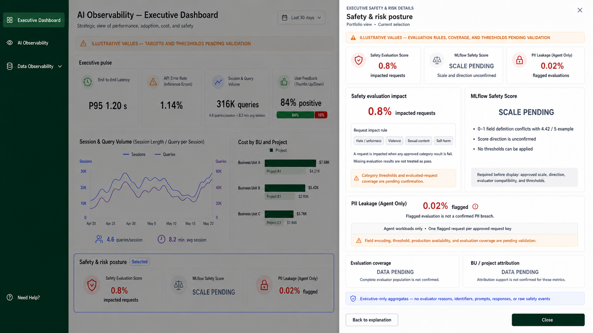

# Executive Dashboard Safety & Risk Details

## Design decision

**Safety & risk posture** is one clickable main-view section. Selecting it
opens the single Executive-only drawer shown above and outlines the entire
section, rather than opening a separate drawer for each of its three cards.

The drawer explains the three portfolio signals without adding unsupported
diagnostic detail:

| Main-view card | Drawer treatment |
|---|---|
| Safety Evaluation Score | Illustrative impacted-request rate and the approved-category pass/fail rule. |
| MLflow Safety Score | `SCALE PENDING` with the exact prerequisites for displaying a number. |
| PII Leakage (Agent Only) | Illustrative flagged-evaluation rate, constrained to agent workloads. |

## Confirmed facts

- Safety Evaluation Score is displayed as an impacted-request percentage, not
  as an averaged numeric severity score. A request is proposed to be impacted
  when any approved category result fails; repeated evaluator records must be
  deduplicated at request grain.
- The mapped safety categories are hate/unfairness, violence, sexual content,
  and self-harm. Executive views must not display evaluator reasons.
- MLflow Safety Score has conflicting `0–1` and `4.42 / 5` source examples,
  and no confirmed score direction or thresholds. `SCALE PENDING` is the
  required state.
- PII Leakage applies to agent workloads only. A flagged evaluation is a
  potential leakage signal, not a confirmed PII breach or security incident.
- Evaluation coverage and organizational attribution are unsupported by the
  current Executive evidence, so the drawer presents both as `DATA PENDING`.

## Likely interpretation

The drawer gives an executive a bounded portfolio-risk explanation: what is
flagged, which safety measurement is not yet displayable, and which evidence
gaps prevent stronger conclusions. It is not an incident-investigation or
evaluator-diagnostics workspace.

## Assumptions used in the mockup

- All displayed rates are illustrative.
- The impacted-request rate uses one impacted request per approved request key
  when at least one included safety result is `fail`.
- The PII flag percentage uses one flagged agent request per approved request
  key when the leakage evaluator produces an approved fail result.
- All filtering, correlation, classification, deduplication, and aggregation
  occur in Splunk or an approved API layer; the dashboard formats aggregates.

## Missing evidence and open decisions

- Approved category thresholds, the canonical `guardrail_triggered` field,
  request correlation, and the evaluated-request coverage contract.
- The authoritative MLflow scale, direction, evaluator compatibility, display
  format, and thresholds.
- PII field encoding, range, threshold, production availability, and agent
  eligibility contract.
- Confirmed business-unit, project, and channel attribution for each safety
  metric.
- Required loading, no-data, stale-data, and API-error states.

## Final image-generation prompt

Use case: `ui-mockup`  
Asset type: Executive Dashboard section-level safety-and-risk drawer

Create a 16:9 Executive Dashboard mockup with the entire **Safety & risk
posture** section selected and a wide right-side drawer titled **Safety & risk
posture**. Include a validation banner; three compact summary cards for
Safety Evaluation Score, MLflow Safety Score, and PII Leakage (Agent Only);
an impacted-request explanation based on the four mapped content-safety
categories; an MLflow `SCALE PENDING` explanation; and an agent-only PII
flagging explanation. Show `DATA PENDING` for evaluation coverage and
BU/project attribution.

Use executive-level aggregates only. Do not show category counts, trends,
model rankings, evaluator reasons, identifiers, raw safety events, prompts,
responses, PII, thresholds, remediation advice, incidents, or breach claims.
Never replace `SCALE PENDING` with a number or call a flagged PII evaluation a
confirmed breach.
