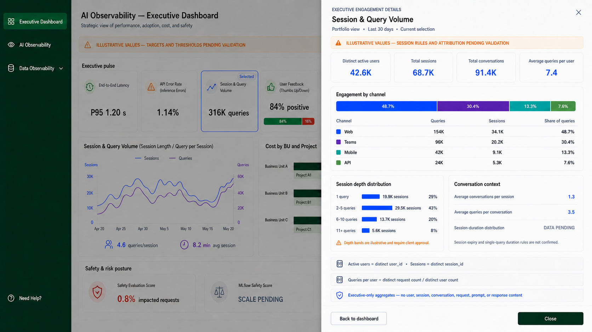

# Executive Dashboard Session and Query Details



## Design decision

The **Session & Query Volume** chart section opens an Executive Engagement
Details drawer. The Session & Query Volume pulse card is no longer an
independent click target: it is represented in the consolidated
[Executive pulse details](executive-dashboard-pulse-details.md) drawer, which
links back to this dedicated engagement detail without repeating its analysis.
This drawer does not repeat the sessions-versus-queries trend already visible
on the dashboard. Instead, it explains engagement reach, channel composition,
session depth, and conversation context.

## Confirmed data support

| Drawer element | Calculation support |
|---|---|
| Distinct active users | Distinct count of `user_id` |
| Total sessions | Distinct count of `session_id` |
| Total conversations | Distinct `session_id` and `conversation_id` combinations |
| Average queries per user | Distinct request count divided by distinct `user_id` count |
| Engagement by channel | Query and session counts grouped by `channel` |
| Session depth distribution | Distinct request count per `session_id`, grouped into depth bands |
| Average conversations per session | Distinct conversations divided by distinct sessions |
| Average queries per conversation | Distinct requests divided by distinct conversations |

The Executive mapping provides `session_id`, `conversation_id`, `user_id`, `channel`, and `timestamp_start`. The detailed UI request schema additionally provides `request_id` and organizational dimensions.

## Likely interpretation

The card answers how much activity exists now, and the main chart answers how sessions and queries move over time. The drawer answers who is participating, which channels drive usage, and how deep sessions and conversations are.

High engagement is not automatically a positive business outcome. The drawer therefore uses neutral engagement colors and does not add health scores, targets, or recommendations.

## Assumptions

- One UI `request_id` represents one user query.
- `session_id` is the approved engagement-session identifier.
- A conversation is uniquely identified by the `session_id` and `conversation_id` combination.
- Channel values are normalized across applications.
- The session-depth bands are illustrative.
- Business-unit and project filters can be applied after reliable request attribution.
- All displayed values are illustrative.
- The Executive drawer contains aggregates only and exposes no identifiers or request content.

## Missing evidence

- The approved definition of a query.
- The canonical request identifier and deduplication rule.
- Session start, expiry, inactivity, and cross-period rules.
- Treatment of single-query sessions.
- Conversation-ID uniqueness rules.
- Treatment of failed, timed-out, cancelled, and content-filtered queries.
- Confirmed channel, business-unit, and project coverage.
- Minimum cohort and privacy-suppression rules.
- Live Splunk query and API response contracts.

Session-duration distribution is shown as `DATA PENDING` because session expiry and single-query duration rules are not confirmed.

## Final image-generation prompts

### Base generation

```text
Use case: ui-mockup
Asset type: executive-only Session & Query Volume detail drawer for an enterprise AI Observability dashboard
Primary request: Generate a new separate 16:9 desktop UI image showing the Executive Dashboard with the "Session & Query Volume" card selected and a wide right-side details drawer open. This is a new mockup derived from the references, not an edit of any source file. The drawer must add engagement composition and depth; it must not repeat the existing sessions-versus-queries time-series chart.
Input images: Image 1 is the approved Executive Dashboard and primary layout reference. Image 2 is the approved wide latency detail drawer and main drawer-pattern reference. Images 3 and 4 are supporting references for executive data distributions, methodology notes, selected-card highlighting, density, typography, and footer treatment.
Scene/backdrop: Keep the approved Executive Dashboard visible and dimmed behind the drawer. Preserve the dark forest-green navigation, dashboard header, amber illustrative-values banner, Executive pulse cards, the existing Session & Query Volume chart, cost section, and safety section. Highlight the "Session & Query Volume" pulse card with a thin blue outline and a small "Selected" pill.
Style/medium: realistic shippable enterprise product UI, crisp sans-serif typography, light warm-gray canvas, white cards, thin gray borders, restrained shadows, executive-friendly density, consistent with all references.
Composition/framing: 16:9 landscape. A wide white drawer occupies about 58% of the screen on the right. The dashboard remains visible on the left under a subtle dark overlay. Close X at the drawer top right.
Drawer header text (verbatim):
- Eyebrow: "EXECUTIVE ENGAGEMENT DETAILS"
- Title: "Session & Query Volume"
- Scope line: "Portfolio view  •  Last 30 days  •  Current selection"
- Pale amber banner: "ILLUSTRATIVE VALUES — SESSION RULES AND ATTRIBUTION PENDING VALIDATION"
Top summary row: four equal compact KPI cards with these exact labels and values:
1. "Distinct active users" — "42.6K"
2. "Total sessions" — "68.7K"
3. "Total conversations" — "91.4K"
4. "Average queries per user" — "7.4"
Main section 1: a large card titled "Engagement by channel". Show one horizontal stacked bar and a readable table beneath it with columns "Channel", "Queries", "Sessions", "Share of queries". Use these exact rows:
- "Web" — "154K" — "34.1K" — "48.7%"
- "Teams" — "96K" — "20.2K" — "30.4%"
- "Mobile" — "42K" — "9.1K" — "13.3%"
- "API" — "24K" — "5.3K" — "7.6%"
Use blue, indigo, teal, and muted green segments; pair every color with text labels.
Main section 2: two side-by-side cards.
Left card title: "Session depth distribution". Use four horizontal bars with exact labels and values:
- "1 query" — "19.9K sessions" — "29%"
- "2–5 queries" — "29.5K sessions" — "43%"
- "6–10 queries" — "13.7K sessions" — "20%"
- "11+ queries" — "5.6K sessions" — "8%"
Add a small amber caption: "Depth bands are illustrative and require client approval."
Right card title: "Conversation context". Show three clean metric rows:
- "Average conversations per session" — "1.3"
- "Average queries per conversation" — "3.5"
- "Session-duration distribution" — "DATA PENDING"
Under DATA PENDING, add: "Session expiry and single-query duration rules are not confirmed."
Methodology and privacy footer: three slim full-width rows with small icons and exact text:
- "Active users = distinct user_id  •  Sessions = distinct session_id"
- "Queries per user = distinct request count / distinct user count"
- "Executive-only aggregates — no user, session, conversation, request, prompt, or response content"
Bottom actions: secondary outlined button "Back to dashboard" and primary dark-green button "Close".
Color palette: forest green navigation, blue and indigo for neutral engagement data, teal and muted green for channel categories, amber only for assumptions/pending validation, gray for unavailable data. Do not use red because no failure or safety condition is shown.
Constraints: Keep every required label and value legible and spelled exactly. Do not add another trend chart. Do not repeat "316K queries", "4.6 queries/session", or "8.2 min avg session" inside the drawer; those already exist on the underlying dashboard. Do not show business-unit or project rankings, application rankings, individual users, user IDs, session IDs, conversation IDs, request IDs, prompts, responses, raw logs, traces, technical component metrics, recommendations, satisfaction claims, targets, or health scores. Do not imply that high engagement is automatically good. No corporate logo, no trademarks, no watermark. Preserve the visual language and selected-card interaction pattern from the reference images.
```

### Card-order correction

```text
Use case: precise-object-edit
Asset type: Executive Dashboard Session & Query Volume detail drawer UI
Input images: Image 1 is the edit target.
Primary request: Correct only the order and icons of the Executive pulse cards visible on the dimmed dashboard behind the drawer. Restore the approved left-to-right order: 1. "End-to-End Latency" with green clock icon and "P95 1.20 s"; 2. "API Error Rate (Inference Errors)" with amber warning-triangle icon and "1.14%"; 3. "Session & Query Volume" with blue trend-line icon, blue selected outline and small "Selected" pill, and "316K queries"; 4. "User Feedback (Thumbs Up/Down)" with green thumbs-up icon and "84% positive" plus the 84%/16% bar; 5. "Cost per Request" remains to the right under the drawer and may stay hidden.
Constraints: Change only those underlying Executive pulse card positions and their icons. Keep the entire right-side drawer pixel-for-pixel unchanged, including every label, value, chart, table, note, button, size, color, and spacing. Keep the dimmed dashboard header, banner, navigation, Session & Query Volume trend chart, Cost by BU and Project section, and Safety & risk posture unchanged. Preserve the overall 16:9 framing, drawer width, overlay, typography, and colors. Do not add or remove content. No watermark.
```

The image was generated and corrected using the built-in image-generation mode. No CLI fallback was used.
