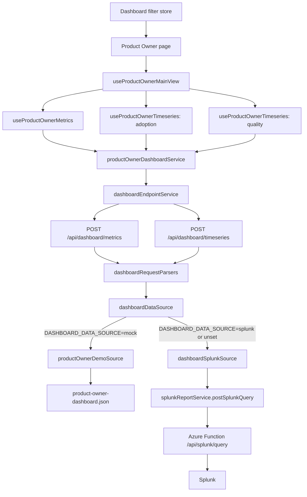

# Hand-over — Product Owner Dashboard Data Connection

## Purpose

This document explains the **current implementation** that connects the Product
Owner dashboard to the shared dashboard endpoints and, through them, to
`lib/services/splunkReportService.ts`.

Only the Product Owner dashboard has been migrated to this architecture:

- [Product Owner dashboard page](../../app/home/product-owner-dashboard/page.tsx)

The Executive, Tech Team, and Operations Team dashboards still use their
persona-specific `main-view` services and routes. Do not assume the architecture
described here is active for those dashboards.

---

## 1. Current architecture at a glance

The Product Owner main view starts three independent React Query requests:

1. one metrics request for the Product Experience Pulse;
2. one timeseries request for Adoption and Engagement; and
3. one timeseries request for Experience and Response Quality.

All three requests use the same browser transport and server-side source
selector.



The browser does not select or know the active provider. Source selection
happens only on the server.

---

## 2. Environment variable and the two data sources

The source is selected by the server-side environment variable:

```env
DASHBOARD_DATA_SOURCE=mock
```

Supported values:

| Value                       | Selected source        | Current result                                                                                                                        |
| --------------------------- | ---------------------- | ------------------------------------------------------------------------------------------------------------------------------------- |
| `mock`                      | Local fixture provider | The Product Owner main view renders from JSON fixtures.                                                                               |
| `splunk`                    | Splunk provider        | Splunk is queried, the raw response is logged, and the API deliberately returns HTTP 501 because response mapping is not implemented. |
| Unset, empty, or whitespace | Splunk provider        | Same behavior as `splunk`; Splunk is the default.                                                                                     |
| Any other value             | None                   | The request fails with an unsupported data-source error, returned as HTTP 502 by the current routes.                                  |

The local repository currently sets:

```env
DASHBOARD_DATA_SOURCE=mock
```

`DASHBOARD_DATA_SOURCE` and `ENVIRONMENT` have different responsibilities:

- `DASHBOARD_DATA_SOURCE` selects `mock` or `splunk` for the dashboard
  endpoints.
- `ENVIRONMENT` is used by `splunkReportService.ts` to decide where to load the
  Splunk Azure Function URL and function secret:
  - `ENVIRONMENT=local`: read `SPLUNK_SERVICE_BASE_URL` and
    `SPLUNK_FUNCTION_SECRET` from local environment variables;
  - any other value: load both values from Azure Key Vault.

Do not expose `DASHBOARD_DATA_SOURCE` to the browser. It must remain a
server-side variable because it controls server integrations and secret-backed
behavior.

### Temporary nature of the mock provider

There are currently two providers so that front-end development and review can
continue before the Splunk response contract is complete. The mock provider is
temporary.

**When Splunk returns the approved, complete Product Owner payload, refactor the
implementation to remove the mock data source and its source-selection branch.**
That cleanup should include:

- removing `DASHBOARD_DATA_SOURCE=mock` usage;
- deleting the Product Owner mock provider;
- deleting Product Owner main-view fixture dependencies that are no longer
  needed;
- removing the `mock | splunk` selection logic if no other dashboard still
  requires it; and
- replacing drawer fixture imports once drawers are covered by live endpoints.

Do not keep the mock and Splunk implementations permanently in parallel. Two
long-lived sources can drift and hide contract problems.

---

## 3. Client-side request flow

### 3.1 Page and filters

The [Product Owner page](../../app/home/product-owner-dashboard/page.tsx) reads
three values from
[dashboardFiltersStore.ts](../../store/dashboardFiltersStore.ts):

- `period`;
- `businessUnit`; and
- `project`.

It passes them to:

```ts
const { metrics, adoption, quality } = useProductOwnerMainView({
  period,
  businessUnit,
  project,
});
```

The page does not fetch directly. It renders the three React Query results and
handles loading, request failure, pending metric, and available-data states.

### 3.2 React Query hooks

[useProductOwnerDashboardEndpoints.ts](../../hooks/useProductOwnerDashboardEndpoints.ts)
contains:

- `useProductOwnerMetrics(filters)`;
- `useProductOwnerTimeseries(chartId, filters)`; and
- `useProductOwnerMainView(filters)`, which composes the three resources.

The requests are independent:

| Query result | Query key                                                                     | Content                                                                    |
| ------------ | ----------------------------------------------------------------------------- | -------------------------------------------------------------------------- |
| `metrics`    | `["product-owner", "metrics", filters]`                                       | Product Experience Pulse and other main-view values in the fixture payload |
| `adoption`   | `["product-owner", "timeseries", "adoption-and-engagement", filters]`         | Adoption and Engagement chart                                              |
| `quality`    | `["product-owner", "timeseries", "experience-and-response-quality", filters]` | Experience and Response Quality chart                                      |

This separation allows one chart to fail or load without blocking the other
chart or the metric cards.

### 3.3 Product Owner request construction

[productOwnerDashboardService.ts](../../lib/services/productOwnerDashboardService.ts)
owns Product-Owner-specific request construction.

It converts UI periods:

| UI value | Endpoint value |
| -------- | -------------- |
| `7d`     | `last_7_days`  |
| `30d`    | `last_30_days` |
| `90d`    | `last_90_days` |

Business unit and project selections are placed into arrays, and the timezone
is fixed to `UTC`.

The metrics request asks for:

- `session-query-volume`;
- `api-error-rate`;
- `end-to-end-latency-p95`; and
- `workflow-completion`.

The timeseries requests ask for:

- Adoption and Engagement: `sessions`, `queries`;
- Experience and Response Quality: `groundedness`,
  `relevance-quality`, `intent-resolution`.

### 3.4 Shared browser transport

[dashboardEndpointService.ts](../../lib/services/dashboardEndpointService.ts)
is the reusable browser-to-Next.js HTTP layer:

- `getMetrics()` posts to `/api/dashboard/metrics`;
- `getTimeseries()` posts to `/api/dashboard/timeseries`.

It is generic over the response type and contains no Product Owner business or
presentation logic.

The Product Owner adapters in
[productOwnerEndpointAdapter.ts](../../lib/dashboard/productOwnerEndpointAdapter.ts)
are currently pass-through functions. They are retained as an explicit seam,
but they do not validate or transform responses today.

---

## 4. Server-side endpoint flow

The two route handlers are:

- [metrics route](../../app/api/dashboard/metrics/route.ts);
- [timeseries route](../../app/api/dashboard/timeseries/route.ts).

Each route:

1. reads the JSON request;
2. passes it through the dashboard request parser;
3. calls the shared data-source selector;
4. serializes the provider response; and
5. maps failures to an HTTP response.

Current status mapping:

| Failure                                          | HTTP status |
| ------------------------------------------------ | ----------- |
| Request parser error                             | 400         |
| `DashboardSplunkContractError`                   | 501         |
| Other provider, configuration, or upstream error | 502         |

### Important validation debt

[dashboardRequestParsers.ts](../../lib/server/dashboard/dashboardRequestParsers.ts)
currently delegates to parser functions in
[productOwnerDemoSource.ts](../../lib/server/dashboard/productOwnerDemoSource.ts).
Those functions currently cast the incoming payload to the DTO type without
runtime validation.

The previous demo-only validation is commented out because its hard-coded
business-unit and project allowlists rejected real filters before a Splunk
request could be tested.

This is active technical debt. Before treating the endpoints as production
ready:

- move validation into the shared parser module;
- validate the full request shape at runtime;
- use approved environment-appropriate filter values; and
- keep validation independent of the mock provider.

---

## 5. Mock data path

With:

```env
DASHBOARD_DATA_SOURCE=mock
```

[dashboardDataSource.ts](../../lib/server/dashboard/dashboardDataSource.ts)
calls:

- `loadMockMetrics(request)`; or
- `loadMockTimeseries(request)`.

Both functions live in
[productOwnerDemoSource.ts](../../lib/server/dashboard/productOwnerDemoSource.ts).

### Metrics

`loadMockMetrics` reads and returns
[product-owner-dashboard.json](../../public/mocks/new-pages/product-owner-dashboard.json)
unchanged. It does not apply the request filters, select only requested
metrics, recalculate values, or scale the payload.

Therefore, changing period, business unit, or project changes the React Query
cache key and sends a new request, but it does **not** change the values returned
by the metrics mock.

### Timeseries

`loadMockTimeseries` reads the same Product Owner fixture and selects one of:

- `adoptionAndEngagement`; or
- `experienceAndResponseQuality`.

It converts fixture entries into the timeseries response envelope:

- series with points become `status: "OK"`;
- empty series become `status: "CALCULATION_PENDING"`;
- supporting values become `status: "OK"`;
- missing or pending supporting values become `status: "DATA_PENDING"`.

It echoes the requested filters in response metadata and marks the response
`illustrative: true`, but it does not filter, slice, scale, or recalculate the
fixture values.

---

## 6. Splunk data path

With:

```env
DASHBOARD_DATA_SOURCE=splunk
```

[dashboardDataSource.ts](../../lib/server/dashboard/dashboardDataSource.ts)
calls:

- `loadSplunkMetrics(request)`; or
- `loadSplunkTimeseries(request)`.

Both functions live in
[dashboardSplunkSource.ts](../../lib/server/dashboard/dashboardSplunkSource.ts).

### Current request behavior

Both loaders currently:

1. dynamically import
   [splunkReportService.ts](../../lib/services/splunkReportService.ts);
2. calculate a fixed range from the current time back 30 days;
3. call `fetchSplunkReport.postSplunkQuery(...)` with:
   - search: `| savedsearch consolidated_metric_final`;
   - the calculated start time;
   - the calculated end time;
4. log the raw response; and
5. throw `DashboardSplunkContractError`.

The dynamic import is intentional. The Azure Key Vault module can fail during
module loading when `KEY_VAULT_URL` is absent; delaying the import prevents that
from breaking mock mode.

### Call made by `splunkReportService`

`postSplunkQuery(searchQuery, startTime, endTime)` loads the Azure Function
configuration and sends:

```http
POST {SPLUNK_SERVICE_BASE_URL}/api/splunk/query?code={functionSecret}
Content-Type: application/json

{
  "SEARCH_QUERY": "| savedsearch consolidated_metric_final",
  "START_TIME": "<ISO timestamp>",
  "END_TIME": "<ISO timestamp>"
}
```

The Azure Function is expected to execute the query against Splunk and return
the result.

### What is and is not implemented

The Splunk path currently proves that the application can reach the Azure
Function and receive a raw response. It does **not** yet provide dashboard
data.

Specifically:

- both metrics and timeseries call the same saved search;
- the requested `7d`, `30d`, or `90d` period is ignored and replaced by a fixed
  30-day range;
- business-unit, project, and timezone filters are not forwarded;
- the request's metric IDs and `chartId` are not used for saved-search routing;
- raw Splunk fields are not mapped to Product Owner response payloads;
- the full raw response is logged; and
- after the successful query, the loader deliberately throws, so the API
  returns HTTP 501 and React Query exposes an error to the page.

This deliberate failure avoids returning an endpoint DTO with the wrong shape.
The page currently expects the Product Owner page payload for metrics, while
the final Splunk mapping contract has not been approved.

The detailed reason for this temporary behavior is recorded in
[Splunk response failure technical debt](./technical-debt-splunk-response-failure.md).

---

## 7. Payload and type boundaries

Transport request DTOs are declared in
[dashboardEndpointDtos.ts](../../types/dashboardEndpointDtos.ts). They currently
support only `dashboard: "product-owner"`.

The page-facing shapes are declared in
[productOwnerDashboard.ts](../../types/productOwnerDashboard.ts):

- `ProductOwnerDashboardMetricsPayload`;
- `ProductOwnerDashboardTimeseriesPayload`;
- metric availability and timeseries result types.

The intended final boundary is:

```text
raw Splunk/Azure Function response
  -> server-side mapper
  -> Product Owner endpoint response
  -> optional client adapter
  -> React Query result
  -> Product Owner page
```

The server-side mapper is the missing part. The current mock metrics path
already returns the page payload directly, while the Splunk loader is typed as
returning `MetricsResponseDto`. Do not resolve this mismatch with a type cast or
an empty response. Define and enforce one approved response contract.

Unavailable data should continue to use explicit states such as:

- `DATA_PENDING`;
- `CALCULATION_PENDING`;
- `FILTER_BREAKDOWN_UNAVAILABLE`;
- `NO_DATA`; and
- `ERROR`.

Do not substitute `0` for unavailable data.

---

## 8. Data still coming directly from mock files

The five Product Owner drawers are not part of the endpoint pipeline. The page
imports their JSON files directly:

- `product-owner-adoption-and-engagement.json`;
- `product-owner-channel-mix.json`;
- `product-owner-experience-quality.json`;
- `product-owner-product-experience-pulse.json`;
- `product-owner-trust-evidence.json`.

Channel Mix in the main view also uses a local in-file `channelMixValues` array
because it is not part of the current endpoint contract.

The old Product Owner `GET /api/product-owner-dashboard/main-view` route and the
retired
[`_productOwnerDashboardService.ts`](../../lib/services/_productOwnerDashboardService.ts)
still exist in the repository, but the current Product Owner page does not call
them.

When the Splunk contracts cover the full page and drawer details, remove these
remaining mock imports and obsolete legacy files as part of the same migration.

---

## 9. Work required to complete the Splunk integration

Before the Splunk provider can return usable dashboard data:

1. Approve the saved-search name or routing rule for the metrics request and
   each timeseries `chartId`.
2. Decide whether the Azure Function accepts a saved search, a query, or a
   report identifier; do not construct unrestricted queries from browser input.
3. Forward the validated period, business-unit, project, and timezone filters.
4. Replace the fixed 30-day range with the validated request range.
5. Approve the raw Splunk field aliases and response schema.
6. Implement a server-side mapper from the raw Splunk response to one agreed
   Product Owner response contract.
7. Add runtime validation for both requests and mapped responses.
8. Replace full raw-response logging with scoped operational logging that does
   not expose sensitive data.
9. Add successful, empty, malformed, and upstream-failure tests for both
   endpoints.
10. Migrate Channel Mix and the five drawers to endpoint data.
11. After live data is stable, delete the mock provider, fixture dependencies,
    source-selection branch, and legacy Product Owner main-view path.

Until these steps are complete, use:

```env
DASHBOARD_DATA_SOURCE=mock
```

for a working Product Owner dashboard. Use `splunk` only for controlled
connectivity and response-contract work; it is expected to return HTTP 501
after the external request.

---

## 10. File map

| Responsibility                     | Current file                                                                                                     |
| ---------------------------------- | ---------------------------------------------------------------------------------------------------------------- |
| Product Owner UI                   | [app/home/product-owner-dashboard/page.tsx](../../app/home/product-owner-dashboard/page.tsx)                     |
| React Query resources              | [hooks/useProductOwnerDashboardEndpoints.ts](../../hooks/useProductOwnerDashboardEndpoints.ts)                   |
| Product Owner request construction | [lib/services/productOwnerDashboardService.ts](../../lib/services/productOwnerDashboardService.ts)               |
| Shared browser transport           | [lib/services/dashboardEndpointService.ts](../../lib/services/dashboardEndpointService.ts)                       |
| Client pass-through adapters       | [lib/dashboard/productOwnerEndpointAdapter.ts](../../lib/dashboard/productOwnerEndpointAdapter.ts)               |
| Metrics route                      | [app/api/dashboard/metrics/route.ts](../../app/api/dashboard/metrics/route.ts)                                   |
| Timeseries route                   | [app/api/dashboard/timeseries/route.ts](../../app/api/dashboard/timeseries/route.ts)                             |
| Request parsing boundary           | [lib/server/dashboard/dashboardRequestParsers.ts](../../lib/server/dashboard/dashboardRequestParsers.ts)         |
| `mock` / `splunk` selection        | [lib/server/dashboard/dashboardDataSource.ts](../../lib/server/dashboard/dashboardDataSource.ts)                 |
| Mock provider                      | [lib/server/dashboard/productOwnerDemoSource.ts](../../lib/server/dashboard/productOwnerDemoSource.ts)           |
| Splunk provider                    | [lib/server/dashboard/dashboardSplunkSource.ts](../../lib/server/dashboard/dashboardSplunkSource.ts)             |
| Azure Function client              | [lib/services/splunkReportService.ts](../../lib/services/splunkReportService.ts)                                 |
| Request DTOs                       | [types/dashboardEndpointDtos.ts](../../types/dashboardEndpointDtos.ts)                                           |
| Page payload types                 | [types/productOwnerDashboard.ts](../../types/productOwnerDashboard.ts)                                           |
| Main fixture                       | [public/mocks/new-pages/product-owner-dashboard.json](../../public/mocks/new-pages/product-owner-dashboard.json) |
