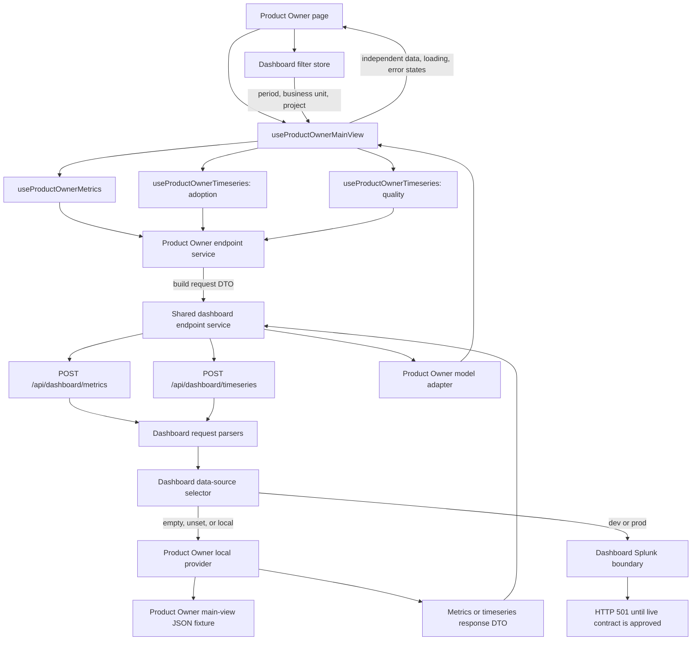

# Implemented dashboard data architecture

## Purpose

This document records the dashboard endpoint architecture implemented so far.
It complements the [initial architecture proposal](./dashboard-data-architecture.md),
which remains the longer-term design reference.

The current implementation covers the Product Owner main view, the shared
browser-to-Next.js transport, local mock data, server-side source selection, and
the safety boundary for a future Splunk connection. It does not yet migrate the
five Product Owner drawers or implement a live, filtered Splunk request.

This document reflects the working tree on 2026-09-29.

## How the implementation evolved

The current branch shows four useful snapshots:

| Revision | What it established |
| --- | --- |
| `7b3641a` (`demo`) | Product Owner endpoint DTOs, model adapters, React Query hooks, local endpoint fixtures, and an architecture demo page. |
| `adc88fa` (`implementation docs`) | The [initial architecture proposal](./dashboard-data-architecture.md). This is the commit immediately before the current branch `HEAD`. |
| `2b586dd` (`stage 0`) | Shared browser transport, explicit server-side source selection, environment parsing, route validation, and the first dashboard Splunk boundary. |
| Current working tree | Moves the endpoint flow into the real Product Owner page, renames the main-view hook, adds the main-view fixture, keeps drawers on their existing mocks, and changes the incomplete Splunk path to fail before an unsafe or unfiltered request. |

The initial proposal described the intended final separation of page, hook,
transport, route, provider, mapper, and Splunk saved search. The implementation
now has most of those boundaries. The local provider is operational. The live
provider and raw-Splunk-to-endpoint mapper are intentionally blocked until the
external contracts are confirmed.

## Decisions now represented in code

1. The Product Owner main view uses one metrics request and one timeseries
   request for each of its two supported chart families.
2. The three requests remain independent React Query resources. There is no
   combined Product Owner dashboard payload.
3. Browser HTTP calls are shared through one transport service. Product Owner
   request construction and model adaptation remain in the Product Owner
   service.
4. Both routes validate the request before selecting the server-side data
   source.
5. An empty, unset, or `local` `ENVIRONMENT` uses local mocks.
6. `dev` and `prod` select the Splunk boundary and never fall back to mocks,
   regardless of the local design-mode flag.
7. Unsupported environment values fail clearly.
8. A deployed request fails with HTTP 501 while the saved-search, filter, and
   result-field contracts are incomplete. It does not make an unfiltered
   Splunk request.
9. Missing or unapproved metrics are shown as explicit availability states.
   Pending data is not represented as zero.
10. All five drawers remain on their existing mock files for the next stage.

## Current end-to-end main-view flow

The entry point is the real [Product Owner page](../../app/home/product-owner-dashboard/page.tsx).
The architecture demo remains available as a review surface, but it now calls
the same renamed main-view hook.



### Step-by-step flow

1. The [Product Owner page](../../app/home/product-owner-dashboard/page.tsx)
   reads `period`, `businessUnit`, and `project` from the dashboard filter
   store.
2. The page calls
   [`useProductOwnerMainView`](../../hooks/useProductOwnerDashboardEndpoints.ts).
3. The composition hook starts three independent queries:
   one metrics query, the Adoption and Engagement timeseries query, and the
   Experience and Response Quality timeseries query.
4. The
   [Product Owner endpoint service](../../lib/services/productOwnerDashboardEndpointService.ts)
   converts UI filters to endpoint filters, selects the supported metric IDs or
   chart metrics, and constructs the request DTO.
5. The
   [shared dashboard endpoint service](../../lib/services/dashboardEndpointService.ts)
   sends the request to `/api/dashboard/metrics` or
   `/api/dashboard/timeseries` and returns the typed response DTO unchanged.
6. The [metrics route](../../app/api/dashboard/metrics/route.ts) or
   [timeseries route](../../app/api/dashboard/timeseries/route.ts) parses and
   validates the body through the
   [dashboard request parsers](../../lib/server/dashboard/dashboardRequestParsers.ts).
7. The
   [dashboard data-source selector](../../lib/server/dashboard/dashboardDataSource.ts)
   reads the normalized runtime environment and chooses the local provider or
   the Splunk boundary.
8. In local mode, the
   [Product Owner local provider](../../lib/server/dashboard/productOwnerDemoSource.ts)
   reads the
   [main-view fixture](../../public/mocks/new-pages/product-owner-dashboard.json),
   applies the supported mock period and scope behavior, and returns an
   endpoint response DTO.
9. The response returns through the route and shared browser transport to the
   Product Owner service.
10. The
    [Product Owner model adapter](../../lib/dashboard/productOwnerEndpointAdapter.ts)
    validates values used by the UI, preserves availability states, and
    converts latency from milliseconds on the wire to seconds in the view
    model.
11. React Query caches each resource separately and gives the page independent
    data, loading, and error states.

## Why the main view has three queries

The page calls one composition hook, but that hook returns three query results:

```ts
const { metrics, adoption, quality } = useProductOwnerMainView(filters);
```

This keeps the page call site small while preserving independent resource
behavior. The metric cards can render even if one chart fails, and either chart
can show its own loading or error state without blocking the other sections.

The current grouping is:

| Query | Data requested |
| --- | --- |
| Metrics | Session and Query Volume, API Error Rate, End-to-End Latency P95, and Workflow Completion |
| Adoption timeseries | Sessions, queries, queries per session, and average session duration |
| Quality timeseries | Groundedness, relevance quality, intent resolution, retrieval quality, and task adherence |

A request per card would create unnecessary network and cache overhead. One
combined page payload would couple unrelated loading and failure states. The
composition hook provides one page-facing API while the resource hooks preserve
the useful separation.

## Responsibility boundaries

| Layer | Current responsibility |
| --- | --- |
| [Product Owner page](../../app/home/product-owner-dashboard/page.tsx) | Reads UI filters, calls the main-view hook, adds labels and presentation, and renders independent request states. |
| [Product Owner hooks](../../hooks/useProductOwnerDashboardEndpoints.ts) | Define React Query keys and compose the three main-view resources. |
| [Product Owner endpoint service](../../lib/services/productOwnerDashboardEndpointService.ts) | Converts filters, selects Product Owner metrics and charts, constructs DTOs, and invokes Product Owner adapters. |
| [Shared endpoint service](../../lib/services/dashboardEndpointService.ts) | Owns the two browser-to-Next.js POST calls and returns typed response DTOs. |
| [Metrics route](../../app/api/dashboard/metrics/route.ts) and [timeseries route](../../app/api/dashboard/timeseries/route.ts) | Parse the request, invoke the selected source, and translate known server errors into HTTP responses. |
| [Request parsers](../../lib/server/dashboard/dashboardRequestParsers.ts) | Expose the route-facing validation boundary. The underlying validators are currently Product Owner-specific. |
| [Data-source selector](../../lib/server/dashboard/dashboardDataSource.ts) | Chooses local or deployed behavior from `ENVIRONMENT`. |
| [Local provider](../../lib/server/dashboard/productOwnerDemoSource.ts) | Validates Product Owner requests and creates response DTOs from the local fixture. |
| [Splunk boundary](../../lib/server/dashboard/dashboardSplunkSource.ts) | Prevents unsafe live calls and identifies the missing contracts required for the live provider. |
| [Product Owner model adapter](../../lib/dashboard/productOwnerEndpointAdapter.ts) | Converts endpoint DTOs into Product Owner view models and rejects malformed values. |

## DTO and model boundaries

The implemented code has one active mapping boundary and one deferred mapping
boundary.

```text
raw Splunk result
    -> server mapper                         DEFERRED
    -> MetricsResponseDto / TimeseriesResponseDto
    -> Product Owner model adapter           IMPLEMENTED
    -> Product Owner page models
```

The wire contracts are defined in
[dashboardEndpointDtos.ts](../../types/dashboardEndpointDtos.ts). They include:

- request filters and applied filters;
- Product Owner metric and chart identifiers;
- metrics and timeseries requests;
- metrics, series, supporting-stat, and response DTOs;
- the availability states `OK`, `DATA_PENDING`, `CALCULATION_PENDING`,
  `FILTER_BREAKDOWN_UNAVAILABLE`, `NO_DATA`, and `ERROR`.

The UI-facing models are defined in
[productOwnerDashboardModels.ts](../../types/productOwnerDashboardModels.ts).
They give the Product Owner page named fields such as `queries`, `sessions`,
`errorRatePercent`, and `seconds` instead of making components inspect unknown
wire values.

The model adapter is deliberately pure: it performs no HTTP calls and has no
React dependencies. It validates finite numeric values, preserves unavailable
states and reasons, and converts the endpoint latency value from milliseconds
to seconds.

No raw Splunk field mapping has been implemented. The existing adapter operates
only after a valid endpoint DTO already exists.

## Environment and source selection

The dashboard endpoint environment behavior is centralized in
[localDesignMode.ts](../../lib/localDesignMode.ts).

| `ENVIRONMENT` | Selected source | Result today |
| --- | --- | --- |
| Unset | Local provider | Existing mock responses |
| Empty or whitespace | Local provider | Existing mock responses |
| `local` | Local provider | Existing mock responses |
| `dev` | Splunk boundary | HTTP 501 with the missing contract details |
| `prod` | Splunk boundary | HTTP 501 with the missing contract details |
| Any other value | None | Clear unsupported-environment error, returned by the routes as HTTP 500 |

Dashboard source selection does not depend on
`NEXT_PUBLIC_LOCAL_DESIGN_MODE`. The flag can still control existing UI design
behavior, but it cannot make `dev` or `prod` use mocks.

The routes use these response categories:

| Condition | HTTP status |
| --- | --- |
| Invalid request body or unsupported Product Owner request value | 400 |
| Missing dashboard Splunk contract | 501 |
| Unsupported `ENVIRONMENT` | 500 |
| Other provider or upstream failure | 502 |

## Local provider behavior

The local provider reads
[product-owner-dashboard.json](../../public/mocks/new-pages/product-owner-dashboard.json).
It supports the filter values used by the current UI:

- periods `7d`, `30d`, and `90d`, represented on the endpoint as
  `last_7_days`, `last_30_days`, and `last_90_days`;
- business units `all`, `a`, and `b`;
- projects `all`, `a1`, and `b1`;
- timezone `UTC`.

It slices chart points to the requested period and applies the existing mock
scope factor for business-unit and project selections. These calculations are
illustrative local behavior. They are not definitions for the future Splunk
saved searches.

Local responses include `meta.illustrative: true` and echo the validated scope
in `meta.appliedFilters`.

## Main-view coverage

The real Product Owner page no longer presents uncovered hardcoded numbers as
live endpoint results.

| Main-view section | Current source | Current behavior |
| --- | --- | --- |
| User Feedback summary | Main-view endpoint (`useDashboardProductOwnerMainView`) | Not in the metrics/timeseries contract. The local fixture returns an illustrative feedback aggregate. |
| Session and Query Volume | Metrics endpoint | Local fixture returns queries, sessions, and queries per session. |
| API Error Rate | Metrics endpoint | Local response is `CALCULATION_PENDING` until error classification and eligible-request rules are approved. When OK, the card renders the rate and request counts. |
| End-to-End Latency P95 | Metrics endpoint | Local fixture returns milliseconds; the Product Owner adapter exposes seconds. |
| Workflow Completion | Metrics endpoint | Local response is `DATA_PENDING`; no numeric value is substituted. |
| Adoption and Engagement | Timeseries endpoint | Local fixture returns sessions, queries, and supported statistics. The chart has its own loading and error state. |
| Channel Mix | No executable endpoint contract | Main view shows a local illustrative channel breakdown, labeled as illustrative. |
| Experience and Response Quality | Timeseries endpoint | Local fixture returns approved series and statistics. Intent Resolution remains `CALCULATION_PENDING`. The chart has its own loading and error state. |
| Feature Usage Evidence | Main-view endpoint (`useDashboardProductOwnerMainView`) | Not in the metrics/timeseries contract. Shows `DATA PENDING` with the reason from the main-view payload. |
| Trust and Measurement Readiness | Main-view endpoint (`useDashboardProductOwnerMainView`) | Not in the metrics/timeseries contract. Rows show explicit calculation, data, or test-result pending states, or a supplied value. |

The metrics query has one loading and error state shared by the four metric
cards because those values are intentionally fetched in one request. Each chart
query has a separate loading and error state.

## Current Splunk boundary

The [dashboard Splunk boundary](../../lib/server/dashboard/dashboardSplunkSource.ts)
does not currently call Splunk. In `dev` and `prod`, it throws a typed contract
error before credentials are loaded or an Azure Function request is made.

This is required because the existing
[Splunk report service](../../lib/services/splunkReportService.ts) accepts only
a saved-search name. Its Azure Function call sends `saved_search_name` and does
not provide a confirmed way to forward the validated dashboard filters. It also
returns pipeline-specific rows and treats an empty result set as an error. That
service remains unchanged for its existing pipeline callers.

The committed `stage 0` implementation briefly attempted to reuse that service
with environment-configured saved-search names, log the raw rows, and return
placeholder `ERROR` DTOs. That path did not bind the requested time range,
business unit, project, or timezone. The current implementation removes that
unfiltered call rather than presenting it as a working dashboard connection.

The following information is required before the live call can be implemented:

1. Approved saved-search names and routing for the metrics request and each
   supported `chartId`.
2. Azure Function argument names for `timeRange`, `businessUnits`, `projects`,
   and `timezone`.
3. Encoding rules for the array-valued business-unit and project filters.
4. Confirmation that the Azure Function forwards those arguments to approved
   saved-search placeholders.
5. Approved result fields for the metrics and timeseries response DTOs.

After those contracts are provided, the Splunk boundary can safely select an
allowlisted saved search, bind validated filters, call the Azure Function, log
the raw result for connection review, and later pass the rows to a server-side
mapper. Until then, there is no raw response to map or log safely.

## Drawer status and stage-two work

All five Product Owner drawers still receive their existing imported mock JSON
objects directly from the real page:

- Product Experience Pulse;
- Adoption and Engagement;
- Channel Mix;
- Experience and Response Quality;
- Trust Evidence.

This creates accepted review-stage differences:

| Drawer | Difference from the main view |
| --- | --- |
| Product Experience Pulse | The drawer still contains the earlier User Satisfaction content, while the main view uses API Error Rate and explicit pending states. |
| Adoption and Engagement | The drawer uses its own static mock and does not reuse the filtered main-view query result. |
| Channel Mix | The drawer still has numerical mock data while the main view states that the endpoint data is pending. |
| Experience and Response Quality | The drawer uses static mock context rather than the filtered main-view query result. |
| Trust Evidence | The drawer uses static mock readiness content while the main view shows explicit pending states. |

Stage two should decide, drawer by drawer, whether to reuse the corresponding
main-view query cache or request additional detail only when the drawer opens.
The Product Owner adapter and endpoint contracts should be extended only for
confirmed drawer fields.

## Known contract and reuse gaps

### Documentation and executable DTOs differ

The executable Product Owner DTO currently requests API Error Rate and only the
`product-experience-pulse` metrics section. The existing
[shared endpoint documentation](../endpoints/shared-dashboard-endpoints.md) and
[Product Owner Splunk data contract](../endpoints/product-owner-dashboard-splunk-data-contract.md)
still contain earlier User Satisfaction and trust-metric examples.

That mismatch must be resolved before those documents can serve as the approved
saved-search result contract. The running code does not infer a live mapping
from the older examples.

### Shared transport is reusable; current contracts are Product Owner-specific

The [shared endpoint service](../../lib/services/dashboardEndpointService.ts)
is ready for other dashboards to reuse the same two HTTP calls. Each future
dashboard should keep its own filter conversion, metric and chart selection,
request construction, and response adapters.

The current DTO discriminator, request validators, server provider, and local
fixtures support only `dashboard: "product-owner"`. Adding the Executive,
Operations Team, and Technical Teams dashboards requires approved identifiers
and response fields, followed by deliberate generalization of those server
contracts. No services for those dashboards have been created yet.

## Implementation file map

| Concern | File |
| --- | --- |
| Real main view | [Product Owner page](../../app/home/product-owner-dashboard/page.tsx) |
| Review page | [Architecture demo page](../../app/home/product-owner-dashboard/architecture-demo/page.tsx) |
| Resource and composition hooks | [Product Owner endpoint hooks](../../hooks/useProductOwnerDashboardEndpoints.ts) |
| Product Owner request construction | [Product Owner endpoint service](../../lib/services/productOwnerDashboardEndpointService.ts) |
| Shared browser transport | [Dashboard endpoint service](../../lib/services/dashboardEndpointService.ts) |
| Metrics API | [Metrics route](../../app/api/dashboard/metrics/route.ts) |
| Timeseries API | [Timeseries route](../../app/api/dashboard/timeseries/route.ts) |
| Route validation boundary | [Dashboard request parsers](../../lib/server/dashboard/dashboardRequestParsers.ts) |
| Environment source selection | [Dashboard data-source selector](../../lib/server/dashboard/dashboardDataSource.ts) |
| Runtime environment parsing | [Local design-mode and environment helper](../../lib/localDesignMode.ts) |
| Local response provider | [Product Owner local provider](../../lib/server/dashboard/productOwnerDemoSource.ts) |
| Deployed safety boundary | [Dashboard Splunk source](../../lib/server/dashboard/dashboardSplunkSource.ts) |
| Existing pipeline Splunk client | [Splunk report service](../../lib/services/splunkReportService.ts) |
| Endpoint wire contracts | [Dashboard endpoint DTOs](../../types/dashboardEndpointDtos.ts) |
| UI model contracts | [Product Owner dashboard models](../../types/productOwnerDashboardModels.ts) |
| DTO-to-model conversion | [Product Owner endpoint adapter](../../lib/dashboard/productOwnerEndpointAdapter.ts) |
| Local main-view data | [Product Owner main-view fixture](../../public/mocks/new-pages/product-owner-dashboard.json) |

## Validation completed for this implementation stage

The recent main-view migration was checked with:

- focused ESLint for the affected implementation files;
- full TypeScript checking with `npx tsc --noEmit --pretty false`;
- `git diff --check`;
- JSON parsing of the new main-view fixture;
- local route checks with unset `ENVIRONMENT` and explicit `local`;
- a filtered `last_7_days`, business-unit `a`, project `a1` request, including
  seven returned chart points and matching applied filters;
- a `dev` request, which returned the expected HTTP 501 contract error.

No deployment was performed.

## Next implementation steps

1. Reconcile the executable Product Owner metric set with the endpoint and
   Splunk contract documentation.
2. Obtain and approve the saved-search routing, Azure Function filter
   arguments, array encoding, placeholder behavior, and result fields.
3. Add a dashboard-specific typed Azure Function request without changing the
   existing pipeline `getReport(savedSearchName)` callers.
4. Make the first filtered live request and log the raw response for review.
5. Define and implement the server mapper from approved Splunk aliases to the
   endpoint DTOs.
6. Migrate the five drawers by reusing main-view query data or adding lazy
   detail queries where the approved drawer contract requires more data.
7. Generalize the dashboard discriminator and server validation only after the
   next dashboard has an approved contract.
