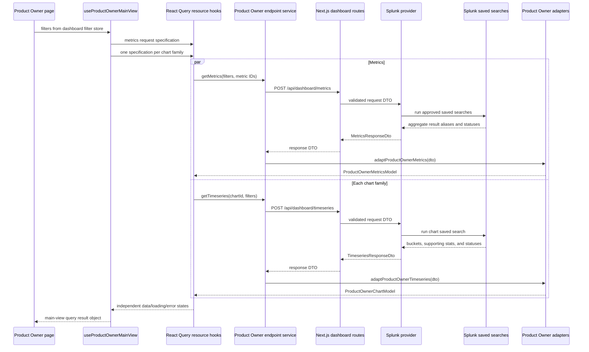
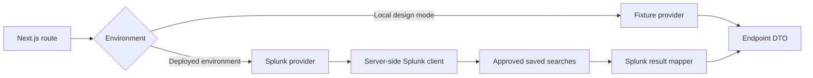

# Next.js to Splunk dashboard data architecture

## Purpose

This document is the implementation reference for connecting the four AI
Observability dashboards to Splunk:

- Product Owner
- Executive
- Operations Team
- Technical Teams

Implement the Product Owner dashboard first. Reuse the same shared endpoint,
DTO, server-provider, caching, and status patterns for the other three
dashboards. Each dashboard keeps its own metric identifiers, chart identifiers,
view models, and model adapters.

The API contracts remain the authority for request fields, response shapes,
metric definitions, filters, and availability states:

- [Shared dashboard endpoints](../endpoints/shared-dashboard-endpoints.md)
- [Shared endpoint strategy](../endpoints/shared-dashboard-endpoint-strategy.md)
- [Product Owner Splunk data contract](../endpoints/product-owner-dashboard-splunk-data-contract.md)
- [Executive Splunk data contract](../endpoints/executive-dashboard-splunk-data-contract.md)
- [Operations Team Splunk data contract](../endpoints/operations-team-dashboard-splunk-data-contract.md)
- [Technical Teams Splunk data contract](../endpoints/tech-team-dashboard-splunk-data-contract.md)

The current Product Owner MVP is a working architecture example. It uses local
fixtures and does not make live Splunk calls:

- [MVP notes](../product-owner-dashboard/endpoint-architecture-demo.md)
- [DTOs](../../types/dashboardEndpointDtos.ts)
- [Product Owner models](../../types/productOwnerDashboardModels.ts)
- [Product Owner model adapters](../../lib/dashboard/productOwnerEndpointAdapter.ts)
- [Product Owner endpoint service](../../lib/services/productOwnerDashboardEndpointService.ts)
- [Product Owner endpoint hooks](../../hooks/useProductOwnerDashboardEndpoints.ts)
- [Local server provider](../../lib/server/dashboard/productOwnerDemoSource.ts)

## Architecture decision

Use several focused data objects and hooks. Do not restore one API response that
contains every card, chart, and drawer.

The application uses:

1. One metrics request for the main-view cards, callouts, and compact bar data.
2. One timeseries request per main-view chart family.
3. Cached main-view results for drawer content that shows the same data.
4. Lazy metrics or timeseries requests for drawer data that is not needed on
   the main view.
5. Static application content for explanatory text, calculation descriptions,
   and decision guidance that does not come from telemetry.

This provides independent loading and error states while avoiding one request
per card. A failure in one chart does not prevent the metrics or other charts
from rendering.

## Components and responsibilities

| Layer | Responsibility | Must not do |
| --- | --- | --- |
| Dashboard page | Read selected filters, call the page and drawer hooks, and render the returned models and states | Call Splunk, understand Splunk aliases, or calculate telemetry aggregates |
| React Query hooks | Define query keys, caching, enabled state, loading, error, and refetch behavior | Convert raw Splunk rows or contain presentation markup |
| Browser service | Build endpoint request DTOs, call the Next.js routes, and pass response DTOs to the persona adapter | Store Splunk credentials or calculate business metrics |
| Persona model adapter | Validate the fields the UI consumes, preserve statuses, convert units, and produce persona-specific view models | Perform HTTP requests or silently replace unavailable data with zero |
| Next.js route | Authorize and validate the request, call the selected server provider, and return the endpoint DTO | Contain page-specific rendering logic |
| Server provider | Choose the approved saved search, pass validated filters, collect results, and invoke the server mapper | Return unchecked Splunk rows to the browser |
| Server mapper | Convert Splunk result aliases and string values into the normalized endpoint DTO | Add UI labels, icons, colors, or component props |
| Splunk saved search | Apply approved filters, correlation, eligibility, deduplication, aggregation, and time bucketing | Return raw prompts, responses, identifiers, or restricted evidence to React |

There are two mapping boundaries:

```text
raw Splunk result -> server mapper -> endpoint response DTO
endpoint response DTO -> persona model adapter -> page or drawer model
```

The first boundary removes Splunk-specific field names and transport quirks.
The second boundary gives the React components the exact object shape they need.

## End-to-end main-view flow

The main view starts the flow by calling its persona composition hook. For the
Product Owner dashboard, the intended hook is `useProductOwnerMainView`.



### Step-by-step behavior

1. The page reads `period`, `businessUnit`, and `project` from the dashboard
   filter store.
2. The page calls `useProductOwnerMainView(filters)` on every render. Hooks are
   never called from an event handler or conditionally.
3. The composition hook calls one metrics hook and one timeseries hook for each
   chart family required by the page.
4. Every query key includes the dashboard, resource type, request identity, and
   normalized filters. A different scope receives a different cached result.
5. The browser service converts UI filter values such as `30d` to the endpoint
   DTO value such as `last_30_days`.
6. The Next.js route validates and authorizes the request before it reaches the
   provider. Splunk credentials remain on the server.
7. The Splunk provider dispatches only approved saved searches and safely binds
   validated filter values. It does not concatenate unchecked input into SPL.
8. Splunk applies the approved population, correlation, deduplication, filters,
   aggregation, and time bucketing.
9. The server mapper converts result aliases and Splunk string values into the
   endpoint DTO. It returns the filters actually applied in
   `meta.appliedFilters`.
10. The browser receives the response DTO. The persona adapter validates fields,
    converts units where required, and creates the view model.
11. React Query caches the model and exposes its data, loading, and error state.
12. The page adds only presentation details such as icons, colors, axes, and
    layout.

## Recommended Product Owner hooks

Use small resource hooks plus page-level composition hooks:

```ts
export function useProductOwnerMetrics(filters: ProductOwnerFilters) {
  return useQuery({
    queryKey: ["product-owner", "metrics", filters],
    queryFn: () => productOwnerDashboardService.getMetrics(filters),
  });
}

export function useProductOwnerTimeseries(
  chartId: ProductOwnerChartId,
  filters: ProductOwnerFilters,
) {
  return useQuery({
    queryKey: ["product-owner", "timeseries", chartId, filters],
    queryFn: () =>
      productOwnerDashboardService.getTimeseries(chartId, filters),
  });
}

export function useProductOwnerMainView(filters: ProductOwnerFilters) {
  const metrics = useProductOwnerMetrics(filters);
  const adoption = useProductOwnerTimeseries(
    "adoption-and-engagement",
    filters,
  );
  const quality = useProductOwnerTimeseries(
    "experience-and-response-quality",
    filters,
  );

  return { metrics, adoption, quality };
}
```

The page receives three query results rather than one combined payload. It can
render metrics while either chart is still loading. More chart hooks can be
added without changing the metrics contract.

The production query keys must also include the requested metric or section set
when callers can request different sets. Sort identifier arrays before putting
them in a key so equivalent requests share the same cache entry.

## Drawer data flow

Drawers follow the same DTO, service, provider, and adapter path. The difference
is when their queries run and how much data they request.

### Drawer rule 1: reuse main-view data

If a drawer expands a card or chart already returned to the main view, read that
model from the existing React Query result. Do not send the same request again.

Examples include the main Adoption and Engagement series and an already loaded
Product Experience Pulse metric. Presentation changes in the drawer belong to
the component or a small view-model selector.

### Drawer rule 2: request missing detail when opened

If a drawer needs additional metrics or series, define a drawer composition hook
and enable its requests only while the drawer is open:

```ts
export function useProductOwnerDrawerData(
  drawerId: ProductOwnerDrawerId,
  filters: ProductOwnerFilters,
  open: boolean,
) {
  const specification = PRODUCT_OWNER_DRAWER_QUERIES[drawerId];

  const metrics = useQuery({
    queryKey: [
      "product-owner",
      "drawer",
      drawerId,
      "metrics",
      specification.metricIds,
      filters,
    ],
    queryFn: () =>
      productOwnerDashboardService.getMetrics(
        filters,
        specification.metricIds,
      ),
    enabled: open && specification.metricIds.length > 0,
  });

  const timeseries = useQueries({
    queries: specification.charts.map((chart) => ({
      queryKey: [
        "product-owner",
        "drawer",
        drawerId,
        "timeseries",
        chart.chartId,
        chart.metricIds,
        filters,
      ],
      queryFn: () =>
        productOwnerDashboardService.getTimeseries(
          chart.chartId,
          filters,
          chart.metricIds,
        ),
      enabled: open,
    })),
  });

  return {
    data: adaptProductOwnerDrawer(
      drawerId,
      metrics.data,
      timeseries.map((query) => query.data),
    ),
    isPending:
      metrics.isPending || timeseries.some((query) => query.isPending),
    isError: metrics.isError || timeseries.some((query) => query.isError),
  };
}
```

Call this hook unconditionally beside the drawer's `open` state. The `enabled`
option controls the network request:

```ts
const [drawerOpen, setDrawerOpen] = useState(false);
const drawer = useProductOwnerDrawerData(
  "adoption-and-engagement",
  filters,
  drawerOpen,
);
```

Opening the drawer starts only the missing requests. Closing it does not discard
the cache. Reopening it can display the cached result according to the configured
stale time.

### Drawer rule 3: keep static guidance out of Splunk

The existing Product Owner drawers contain calculation descriptions, decision
guidance, explanatory notes, and presentation labels. Keep approved static text
in application content files. Splunk should return measured values, series,
coverage, applied filters, and availability statuses.

The drawer adapter combines:

```text
cached main-view models
+ lazy detail models
+ approved static drawer content
= drawer view model
```

### Drawer contracts must be explicit

The current shared contracts define main-view metrics and timeseries. They do
not yet define every Product Owner drawer request or response. Before connecting
a drawer to Splunk, document its metric IDs, chart IDs, value shapes, filters,
units, statuses, and required static content.

Use the existing metrics endpoint for compact values, distributions, and bar
data only when its response contract explicitly defines that value shape. Use
the timeseries endpoint for time buckets. If a drawer needs structured data that
fits neither contract, approve a separate contract before adding a route. Do not
hide an arbitrary table inside an undocumented `value` object.

## Suggested Product Owner drawer request plan

This table describes how to divide the current drawer content. The exact metric
and chart identifiers still require drawer contract approval.

| Drawer | Reuse from main view | Load lazily when opened | Keep as static content |
| --- | --- | --- | --- |
| Product Experience Pulse | Main card metrics and any matching engagement series | Additional responsiveness series or supporting evidence not shown on the page | Calculation explanations and workflow guidance |
| Adoption and Engagement | Sessions, queries, and supporting stats | Session-depth and duration distributions when approved | Explanatory notes and calculation descriptions |
| Channel Mix | Compact channel shares when included in main metrics | Share evolution and channel-specific supporting values | Attribution guidance and labels |
| Experience and Response Quality | Main quality series and supporting scores | Coverage or comparison details not already returned | Comparability guidance and score definitions |
| Trust and Measurement Readiness | Main readiness statuses and approved scores | Additional approved coverage values, if any | Decision interpretation and boundary guidance |

## DTOs and models

DTOs describe data crossing the HTTP boundary. Models describe data consumed by
the React application.

### Shared endpoint DTOs

The shared DTO layer contains:

- `MetricsRequestDto`
- `MetricsResponseDto`
- `TimeseriesRequestDto`
- `TimeseriesResponseDto`
- request and applied-filter DTOs
- the common availability status union

Before applying the MVP to all dashboards, generalize the current
`dashboard: "product-owner"` discriminator to the approved dashboard ID union.
Keep persona metric and chart ID unions separate so one dashboard cannot request
another dashboard's identifiers accidentally.

### Persona models

Each dashboard owns its application models:

```text
ProductOwnerMetricsModel
ProductOwnerChartModel
ProductOwnerDrawerModel

ExecutiveMetricsModel
ExecutiveChartModel
ExecutiveDrawerModel

OperationsMetricsModel
OperationsChartModel
OperationsDrawerModel

TechTeamMetricsModel
TechTeamChartModel
TechTeamDrawerModel
```

Do not expose one large cross-persona model with optional fields for every
dashboard. Shared transport structure belongs in DTOs; persona meaning belongs
in persona models.

### Adapter behavior

A persona adapter must:

- check the dashboard and chart identifiers;
- validate required value fields before the page receives them;
- convert transport units to the model's canonical units;
- preserve `DATA_PENDING`, `CALCULATION_PENDING`,
  `FILTER_BREAKDOWN_UNAVAILABLE`, `NO_DATA`, and `ERROR`;
- reject malformed `OK` values;
- ignore unknown response fields safely;
- avoid deriving business metrics that Splunk owns.

For example, the Product Owner adapter converts the endpoint's latency
milliseconds into the model's seconds. Splunk remains responsible for computing
the approved P95 aggregate.

## Server provider design

Keep the route independent from the data source through a provider interface:

```ts
interface DashboardDataProvider {
  getMetrics(request: MetricsRequestDto): Promise<MetricsResponseDto>;
  getTimeseries(
    request: TimeseriesRequestDto,
  ): Promise<TimeseriesResponseDto>;
}
```

Use a fixture provider in local design mode and a Splunk provider in deployed
environments. Both providers return the same endpoint DTOs, so hooks, browser
services, adapters, and components do not change with the source.



The Splunk provider owns transport concerns such as authentication, timeouts,
saved-search dispatch, job polling, and result retrieval. The mapper owns field
aliases, numeric parsing, nullability, unit normalization, per-item statuses,
and response metadata.

## Loading, errors, and statuses

Keep HTTP request state separate from metric availability:

- `isPending` means the request has not completed.
- `isError` means the endpoint request failed.
- `status: "ERROR"` means an individual metric or series failed while the
  endpoint still returned a valid partial response.
- Pending and no-data statuses are valid responses and should render their
  specified states.

Never convert pending, missing, malformed, or unattributable data to zero.
`NO_DATA` is different from a measured value of zero.

The page should render successful sections independently. A timeseries failure
must not remove successful metric cards, and one unavailable metric must not
fail the complete metrics response.

When filters change, each open resource receives a new query key. A drawer must
show loading for the new scope or close; it must not present cached data from the
previous scope as though it belongs to the current filters.

## Applying the pattern to the other dashboards

The Executive, Operations Team, and Technical Teams dashboards use the same
flow:

```text
persona page
-> persona main-view and drawer composition hooks
-> shared metrics and timeseries transport hooks
-> persona endpoint service and adapter
-> shared Next.js routes
-> dashboard data provider
-> approved Splunk saved searches
```

For each dashboard:

1. Define its metric IDs and chart IDs from its Splunk data contract.
2. Define persona models for the page and drawers.
3. Implement persona adapters from the shared endpoint DTOs.
4. Implement a main-view composition hook with one metrics request and the
   required chart requests.
5. Define drawer query specifications and lazy drawer hooks.
6. Add the dashboard ID and approved request identifiers to server validation.
7. Add saved-search routing and server mapping without changing the shared
   React components.

Do not copy the existing persona-specific `GET /main-view` route pattern into
the new implementation. Those routes and their combined payloads are migration
sources; the target architecture uses the two shared POST endpoints.

## Suggested production file layout

```text
types/dashboardEndpointDtos.ts
types/productOwnerDashboardModels.ts

hooks/dashboard/useDashboardMetrics.ts
hooks/dashboard/useDashboardTimeseries.ts
hooks/product-owner/useProductOwnerMainView.ts
hooks/product-owner/useProductOwnerDrawerData.ts

lib/services/dashboardEndpointService.ts
lib/dashboard/adapters/productOwnerAdapter.ts
lib/dashboard/adapters/executiveAdapter.ts
lib/dashboard/adapters/operationsAdapter.ts
lib/dashboard/adapters/techTeamAdapter.ts

lib/server/dashboard/DashboardDataProvider.ts
lib/server/dashboard/fixtureDashboardDataProvider.ts
lib/server/dashboard/splunkDashboardDataProvider.ts
lib/server/dashboard/splunkResultMapper.ts
lib/server/dashboard/savedSearchRegistry.ts

app/api/dashboard/metrics/route.ts
app/api/dashboard/timeseries/route.ts
```

The MVP file names can be moved toward this layout during production rollout.
Do the move and reference updates together so there is one canonical transport
service and one provider boundary.

## Validation expectations

At minimum, test:

- request DTO validation and rejection of unknown identifiers;
- effective filter normalization and `meta.appliedFilters`;
- each valid `OK` value shape;
- missing and malformed values;
- every pending, no-data, filter-breakdown, and error status;
- Splunk string-to-number parsing;
- unit conversions;
- timeseries date keys and ordering;
- partial success when one metric or series fails;
- query-key separation when filters or requested identifiers change;
- lazy drawer fetching and reuse of cached main-view data;
- a fixture-provider response and a representative Splunk-provider response
  producing the same endpoint DTO and persona model.

The implementation is ready for a dashboard when its main view and drawers no
longer import live-value JSON fixtures, the browser contains no Splunk-specific
field names, and all rendered values or pending states can be traced through an
approved endpoint contract to a saved search and source definition.
