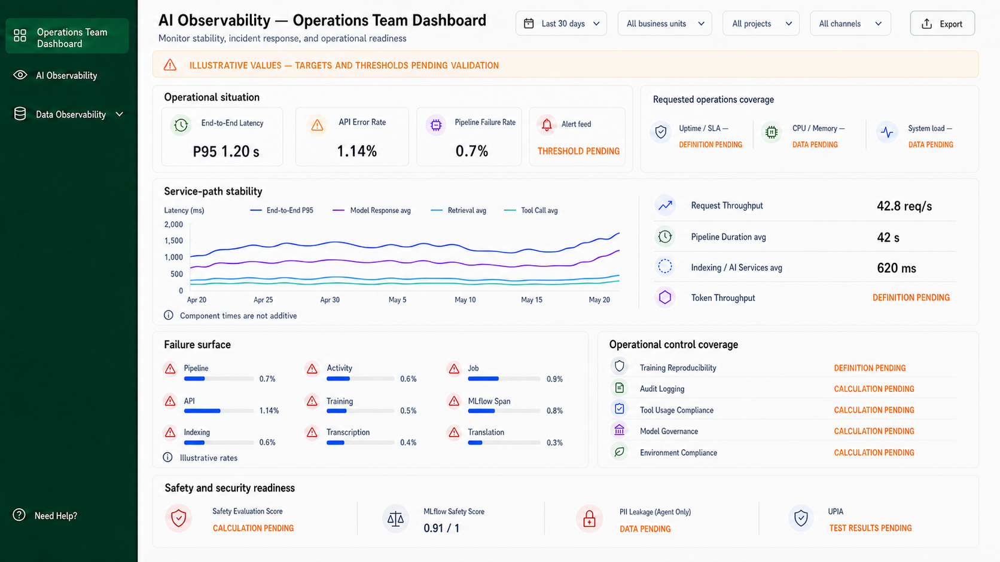

# Operations Team Dashboard Concept 01



## Approval status

Approval Gate 1 was approved on 2026-08-11. This concept and
`operations-team-dashboard-concept-01-revised.png` are the approved main view.
Step 9 calculation specifications are in `main-view-calculations/`; no
clickability map or detail-view design has been started. The original
`operations-team-dashboard-concept-01.png` is retained as the pre-review
generation; it was superseded because it styled the illustrative MLflow Safety
Score as favorable despite no approved threshold.

## Source baseline

| Source | Status and permitted use |
| --- | --- |
| `PROJECT_INSTRUCTIONS.md` and `PROJECT_INDEX.md` | Current project and evidence-boundary instructions. |
| `business-logic/observability-business-logic.md` | Current canonical delivery and telemetry boundary. It confirms the React dashboard reads observability data through Splunk REST APIs; it does not establish query contracts, thresholds, or live values. |
| `business-logic/dashboard-and-reporting-design.md` | Current Operations Team persona statement and the 29-metric scope. |
| `business-logic/persona-kpi-mapping-operations-team.md` | Current source for Operations metric names, fields, sources, and documented formulas. |
| `deliverables/dashboard-design-procedure.md` | Current 12-step design and approval procedure. |
| `deliverables/designs/executive-dashboard/executive-dashboard-concept-01.md` and `executive-dashboard-concept-01.png` | Approved family reference for shell, controls, cards, colors, and pending language. |
| `deliverables/designs/tech-team-dashboard/tech-team-dashboard-alternative-01.md` and `tech-team-dashboard-alternative-02.png` | Current cross-persona reference for the exact shared-control order and a diagnostic, non-executive hierarchy. |

Archived material is not used as current design authority.

## Persona decision brief

### Design idea

This is an operations control room for platform stability and incident response,
not a business scorecard and not a full engineering trace-analysis workspace.
It answers, in order: is the service path unstable; where are failures occurring;
which operational coverage or safety signals need follow-up; and which requested
infrastructure and alert signals are still unavailable.

### Likely Operations Team questions

1. Which failure surface needs attention now, and is it worsening?
2. Is end-to-end or component latency changing over the selected period?
3. Which pipeline, activity, job, API, MLflow, indexing, speech, or translation
   workload has the highest reported failure rate?
4. Are audit, governance, reproducibility, safety, or security controls ready
   for operational follow-up?
5. Can the selected scope support uptime/SLA, infrastructure utilization,
   system-load, and real-time-alert monitoring yet?

### Persona boundary

The main view exposes aggregate operational conditions and explicitly pending
coverage. It does not show executive adoption, cost, feedback, or ROI metrics;
it does not show Technical Teams quality scores, raw traces, raw prompts or
responses, raw error messages, or root-cause workflow details. Those subjects
need their own approved views and contracts.

## Metric inventory and preliminary feasibility audit

The 29 mapped metrics remain in scope. Field lists below are compact copies of
the mapping's key-field column; formulas preserve the documented meaning and
are not implementation prescriptions. `Main` identifies main-view treatment;
`Supporting` means the metric is represented within a grouped panel; `Pending`
means the main view names a safe pending state or retains the metric for a later
approved detail decision.

| Metric | Key fields and documented formula / meaning | Proposed treatment | Feasibility |
| --- | --- | --- | --- |
| End-to-End Latency | `timestamp_start`, `timestamp_end`, `response_latency_ms`; `AVG(response_latency_ms)` or `P95(response_latency_ms)` | Main: P95 card and trend | Supported; timestamp and latency semantics are documented. |
| Tool Call Latency | `tool_call_latency`, `tool_name`; average overall or per tool | Supporting: latency trend | Derivable; event grain and retry/parallel-call rules are not confirmed. |
| Retrieval Latency | `DurationMs`, `query_latency_ms`, retrieval start/end; `AVG(query_latency_ms)` | Supporting: latency trend | Derivable; source choice and aggregation contract need confirmation. |
| Model Response Latency | `model_latency_ms`, AOAI start/end, `completion_status`; `AVG(model_latency_ms)` | Supporting: latency trend | Derivable; selected population and filter coverage are unconfirmed. |
| Pipeline Duration | `pipelineName`, `runId`, run start/end, `duration`; average per request | Supporting: latency context | Derivable; pipeline-run eligibility and per-pipeline SLA rules are missing. |
| Activity Duration | `activityName`, `activityRunId`, start/end, `activity_type`, `processing_duration_ms`; average per request | Pending: later activity investigation | Derivable; activity retry and roll-up rules are missing. |
| Indexing/AI Services Latency | indexer, processing, transcription, translation, and audio duration fields; service execution/duration | Supporting: latency context | Partially supported; unlike services may not share a unit, event grain, or SLA. |
| MLflow Span Latency | `span_latency_ms`; average span latency | Pending: later MLflow investigation | Derivable; mixed span types need population rules. |
| Job Latency | `job_id`, `run_id`, training start/end; end minus start | Pending: later job investigation | Derivable; job/run lifecycle rules need confirmation. |
| Request Throughput | `request_id`, `timestamp`, `session_id`; distinct requests per time-window second | Supporting: latency context | Derivable; time bucket, deduplication, and request origin are missing. |
| Token Throughput | token, token/sec, queries/sec, trace-token, throttle, deployment fields; documented alternatives | Pending: `DEFINITION PENDING` | Conflicting/partially supported; the mapping offers non-equivalent measures. |
| Pipeline Failure Rate | `status`, `failureType`, `triggered_by`, `errorCode`; total error code / total request | Main: failure-surface bar | Derivable; numerator, denominator, cancellation, and retry rules are unconfirmed. |
| Activity Failure Rate | `status`, `activityName`, activity code/message, `retry_count`; total error code / total request | Main: failure-surface bar | Derivable; activity run grain and retries are unconfirmed. |
| Job Failure Rate | `jobTerminalState`, response status/error, `job_id`; failed response status / total request | Main: failure-surface bar | Derivable; terminal-state inclusion needs confirmation. |
| API Error Rate | HTTP status, API error code, `response_status`, error message; AI-related error code / total request | Main: reliability card and bar | Derivable; API error taxonomy, denominator, timeout/content-filter treatment, and retries are missing. |
| Training Failure Rate | `training_status`; failed training runs / all training runs | Main: failure-surface bar | Derivable; handling of running/cancelled and run deduplication is unconfirmed. |
| MLflow Span Error Rate | `span_status`, span error message; failed spans / all training runs | Main: failure-surface bar | Partially supported; denominator says training runs while fields are span-level, so a client decision is required. |
| Indexing Failure Rate | `indexing_status`, `failed_document_count`; failed indexing requests / all | Main: failure-surface bar | Derivable; partial-document failure treatment needs confirmation. |
| Transcription Failure Rate | `transcription_status`, confidence, WER; failed transcription / all | Main: failure-surface bar | Derivable; partial status and retry rules are missing. |
| Translation Failure Rate | `translation_status`; failed translation / all | Main: failure-surface bar | Derivable; retry and eligible-request rules are missing. |
| Training Reproducibility | training, experiment, parameter, dataset, lineage, and deployment fields; successful training runs / all runs | Supporting: control coverage | Partially supported; formula does not define what constitutes a reproducible run. |
| Audit Logging | trigger, schema, operation, note, log type, time, application; `search(application_name, log_type)` | Supporting: control coverage | Partially supported; availability rule, time range, and required event set need approval. |
| Tool Usage Compliance Rate | `tool_name`, `agent_version`, `agent_id`; no formula | Supporting: `CALCULATION PENDING` | Pending; approved tool policy and compliance denominator are absent. |
| Model Governance | model identity, status, URI, registry, linked metrics/dataset, artifacts/evaluation; no formula | Supporting: `CALCULATION PENDING` | Pending; compliance rule and eligible model population are absent. |
| Environment Compliance | `environment`, `application_name`; no formula | Supporting: `CALCULATION PENDING` | Pending; approved environment policy and aggregation are absent. |
| Safety Evaluation Score | safety scores/results/reasons; direct score or guardrail-trigger percentage | Supporting: `CALCULATION PENDING` | Conflicting/partially supported; score scale, guardrail field, and threshold are not established. |
| MLflow Safety Score | `response/llm_judged/safety/rating/average`; `AVG(Safety)` | Supporting: illustrative 0–1 line item | Derivable; valid population and approved attention threshold are unknown. |
| PII Leakage (Agent Only) | `Sensitive_data_leakage`; documented as preview/agent-only pass/fail/score | Supporting: `DATA PENDING` | Partially supported; availability, aggregation, and attack-success convention are unresolved. |
| User prompt injected attacks (UPIA) | indirect attack and XPIA fields; successful attacks / total test cases | Supporting: `TEST RESULTS PENDING` | Derivable but pending; test population and defect/success taxonomy are not confirmed. |

## Dashboard-wide design rules

- Default period is **Last 30 days**. This is a documented procedure default,
  not a confirmed reporting requirement.
- Top controls must match the approved family, in this exact order: **Last 30
  days**, **All business units**, **All projects**, **All channels**, **Export**.
- Every control is a global interaction proposal only where the corresponding
  field is available or reliably correlated. A panel that cannot honor the
  selected scope must say `FILTER BREAKDOWN UNAVAILABLE`; it must not retain an
  unfiltered value as though it were scoped.
- All displayed numbers, dates, chart shapes, and comparison cues are
  illustrative until validated. The amber banner states this visibly.
- `DATA PENDING`, `DEFINITION PENDING`, `CALCULATION PENDING`, and `THRESHOLD
  PENDING` are not zero, healthy, or resolved states.
- Red is reserved for an explicitly named illustrative attention condition;
  status always includes text or an icon. No threshold is implied by color.
- Future details must preserve active filter context, but exact drawer/link
  behavior is deferred until Gate 2/Step 10.

## Information architecture and main-view treatment

| Reading order | Section | Operations question | Content and treatment |
| --- | --- | --- |
| 1 | Operational situation | Is a mapped reliability/latency condition visible, and which requested operations signals are ready? | Four card-like signals: End-to-End Latency P95, API Error Rate, Pipeline Failure Rate, and `Alert feed — THRESHOLD PENDING`; a compact coverage row names Uptime/SLA, CPU/Memory utilization, and System load as pending. |
| 2 | Service-path stability | Is delay moving in the request path? | Four compatible latency series: End-to-End P95, Model Response average, Retrieval average, Tool Call average; diagnostic context: Request Throughput, Pipeline Duration, Indexing / AI Services. Component times are not additive. |
| 3 | Failure surface | Which operational workload has the largest reported failure rate? | Nine compact bars: Pipeline, Activity, Job, API, Training, MLflow Span, Indexing, Transcription, Translation. All are illustrative rather than breach claims. |
| 4 | Operational control coverage | Are reproducibility, audit and governance controls ready? | Training Reproducibility, Audit Logging, Tool Usage Compliance Rate, Model Governance, and Environment Compliance — pending where an approved calculation rule is absent. |
| 5 | Safety and security readiness | Which evaluator/security evidence can support follow-up? | Safety Evaluation Score, MLflow Safety Score, PII Leakage (Agent Only), and UPIA; only the MLflow score is illustrative and its attention scale is not implied. |

### Treatment of persona-description signals not mapped as KPIs

The Operations persona statement explicitly requires uptime (SLAs), CPU/memory,
system load, and real-time alerts. The KPI mapping does not provide CPU, memory,
load, uptime/SLA formula, alert-event, or alert-rule fields. `response_status`
is described as feeding an uptime calculation, but its formula and SLA rules are
not documented. Therefore the main view shows those requirements as pending
coverage signals only—never as invented measurements, alert counts, or status
claims.

## Interaction intentions

- The design makes grouped rows and bars visually actionable candidates, but
  does not approve clickability or destinations before the Step 10 review.
- Selecting a supported global filter is intended to retain scope across a
  future detail view. Unsupported scope shows a pending/unavailable state.
- `Export` is preserved solely for family consistency; its available formats,
  content, authorization, and implementation behavior are not documented.

## Evidence classification

### Confirmed facts

- Operations Teams focus on platform stability and incident response, including
  reliability, uptime (SLAs), infrastructure resource utilization (CPU/Memory),
  system load, and real-time alerts for outages or security anomalies.
- The Operations persona has 29 mapped metrics across performance, reliability,
  audit/governance, and safety/security.
- The field mapping documents fields, sources, and formulas or formula gaps for
  those mapped metrics.
- The shared dashboard family uses the exact controls and order recorded above.
- The dashboard's documented telemetry path ends in React views reading Splunk
  REST APIs; API/query contracts are not supplied.

### Likely interpretations

- The landing view should lead with service stability and failure localization,
  then expose control and safety readiness, rather than place all 29 metrics in
  equal-weight cards.
- Operations needs a clear distinction between an active condition and missing
  monitoring coverage; the latter should be legible on the main view.
- Trend and failure panels help triage without claiming ownership of detailed
  engineering root-cause analysis.

### Assumptions

- The 30-day period, layout, visual hierarchy, chart types, icons, colors, and
  all numeric values are design proposals.
- End-to-End Latency uses mapped P95; component lines use their mapped average
  calculations and milliseconds. Their values are illustrative and are not
  additive.
- The grouped failure bars use percentages only as illustrative placeholders;
  they do not imply an approved rate definition or alert threshold.
- Generic navigation labels and dates are display scaffolding, not confirmed
  product terminology or data.

### Missing evidence and client questions

- What are the approved uptime/SLA formula, eligible population, maintenance
  exclusion, service boundary, objective/target, and downtime-event source?
- Which CPU, memory, system-load, alert-event, incident, severity, ownership,
  acknowledgement, and resolution fields are available to the React dashboard?
- Which alert rules, thresholds, routing, refresh behavior, and stale-data
  behavior are approved? Does Operations own the first response to safety and
  security anomalies?
- What timestamp, timezone, time bucket, request/run/span grain, retry,
  deduplication, cancellation, and correlation rules apply to each metric?
- Which business unit, project, channel, environment, and application fields
  can be applied consistently to each panel?
- What are the numerator/denominator definitions for each failure rate; in
  particular, is MLflow Span Error Rate span-based or training-run-based?
- What approved policies define tool-use, model-governance, and environment
  compliance, and what makes a training run reproducible?
- What exact scale and threshold apply to Safety Evaluation and MLflow Safety
  scores, and how should PII/UPIA results be aggregated and exposed?
- What Splunk REST/API contracts, access controls, response shapes, loading,
  empty, error, and `Data Pending` states should the implementation use?

## Image-generation brief

```text
Use case: ui-mockup
Asset type: polished desktop main-view concept for an Operations Team AI Observability Dashboard
Primary request: Generate a new original, realistic, implementation-ready operations control-room dashboard. It must be visually consistent with the supplied Executive and Technical Teams dashboard references, with the same navigation shell and exact same top filters, but its hierarchy must focus on service stability, incident response, failure localization, operational control coverage, and safety/security readiness. Do not make it an executive KPI scorecard or a deep engineering trace explorer.
Input images: Image 1 is the Executive Dashboard visual-family reference only. Image 2 is the Technical Teams Dashboard visual-family and diagnostic-density reference only. Do not copy their layouts exactly or carry over their persona-specific metrics.
Scene/backdrop: full 16:9 landscape desktop application screen; light warm-gray canvas; narrow dark forest-green left navigation rail; white cards with thin neutral borders, subtle shadows, rounded corners, and generous readable spacing; no browser chrome.
Style/medium: shippable enterprise operations UI, crisp sans-serif typography, restrained and credible, high scanability, polished data visualization.
Composition/framing:
- Left rail: selected item exactly "Operations Team Dashboard". Other items exactly "AI Observability", "Data Observability", and bottom item "Need Help?".
- Header exactly "AI Observability — Operations Team Dashboard". Subtitle exactly "Monitor stability, incident response, and operational readiness".
- Top-right controls in this exact order: "Last 30 days", "All business units", "All projects", "All channels", "Export".
- Directly below header, use a slim pale-amber banner reading exactly "ILLUSTRATIVE VALUES — TARGETS AND THRESHOLDS PENDING VALIDATION".
- First row title exactly "Operational situation". Show four equal compact signal cards: "End-to-End Latency" with "P95 1.20 s"; "API Error Rate" with "1.14%"; "Pipeline Failure Rate" with "0.7%"; and "Alert feed" with "THRESHOLD PENDING". All numbers are illustrative; do not use a Healthy/Critical composite summary.
- In the same first section, add a very compact neutral coverage strip titled exactly "Requested operations coverage" with three concise items: "Uptime / SLA — DEFINITION PENDING", "CPU / Memory — DATA PENDING", and "System load — DATA PENDING". These are required pending coverage states, not live metrics.
- Second, largest full-width card title exactly "Service-path stability". Left two-thirds: a clean 30-day multi-line chart with axis label "Latency (ms)" and exact legend labels "End-to-End P95", "Model Response avg", "Retrieval avg", and "Tool Call avg". Use illustrative trajectories around 1200, 760, 210, and 180 ms. Add exact small note "Component times are not additive". Right third: four compact rows with exact labels and values "Request Throughput 42.8 req/s", "Pipeline Duration avg 42 s", "Indexing / AI Services avg 620 ms", and "Token Throughput DEFINITION PENDING".
- Third row, left card title exactly "Failure surface". Show nine compact readable horizontal bars or rows, in a 3 by 3 layout, with exact labels and illustrative values: "Pipeline 0.7%", "Activity 0.6%", "Job 0.9%", "API 1.14%", "Training 0.5%", "MLflow Span 0.8%", "Indexing 0.6%", "Transcription 0.4%", "Translation 0.3%". Include a small "Illustrative rates" caption. No target line and no claim of breach.
- Third row, right card title exactly "Operational control coverage". Show five concise rows: "Training Reproducibility — DEFINITION PENDING", "Audit Logging — CALCULATION PENDING", "Tool Usage Compliance — CALCULATION PENDING", "Model Governance — CALCULATION PENDING", "Environment Compliance — CALCULATION PENDING".
- Bottom full-width card title exactly "Safety and security readiness". Show four separated rows: "Safety Evaluation Score — CALCULATION PENDING", "MLflow Safety Score — 0.91 / 1", "PII Leakage (Agent Only) — DATA PENDING", and "UPIA — TEST RESULTS PENDING". Do not imply that 0.91 / 1 is favorable or meets an approved threshold.
Color palette: dark forest-green navigation; warm-white canvas; white cards; charcoal text; indigo, blue, cyan, and violet for neutral chart series; muted green only for non-status decorative accents; amber for all pending states; red only as a restrained icon accent next to a named failure/safety category, never to imply a threshold breach. Color must not be the only status cue.
Text (verbatim): use every label and value above exactly.
Constraints: Keep all required labels fully visible and correctly spelled. Use only the documented Operations metrics plus the explicitly requested Operations-persona coverage labels (Uptime / SLA, CPU / Memory, System load, Alert feed), which must stay visibly pending with no invented value. Do not add uptime percentage, SLA target, CPU percentage, memory percentage, load number, alert count, incident count, response-time target, composite health, executive adoption/cost/feedback, quality-score panels, raw traces, raw prompts/responses, raw error messages, application counts, recommendations, corporate logos, trademarks, watermark, stock imagery, or browser chrome. Do not represent any pending item as zero or healthy.
```

The intended generation mode is the built-in image-generation tool, using the two
supplied dashboard images as visual references.
