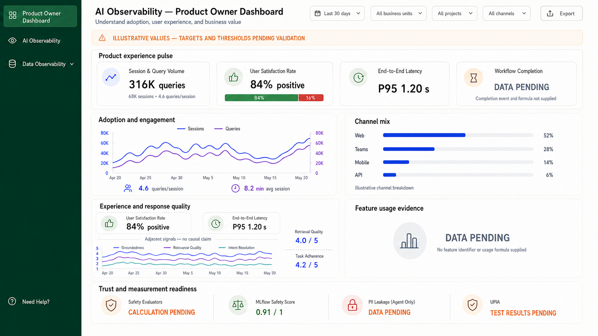

# Product Owner Dashboard Concept 01



## Approval status

This document completed steps 1-8 of the Persona Dashboard Design Procedure.
Approval Gates 1 through 4 are approved. The six selected Gate 3 detail views
were individually revised and approved by the user; their version-02 images are
the current interaction authority in the clickability map. The approved final
review completes this dashboard under the procedure. Every number in the
companion image remains illustrative, not a validated production result.

## 1. Source baseline

Current sources used for this concept:

- `PROJECT_INSTRUCTIONS.md` and `PROJECT_INDEX.md` for authority, evidence
  classification, and confidentiality boundaries.
- `deliverables/dashboard-design-procedure.md` for the required workflow,
  feasibility states, and approval gates.
- `business-logic/dashboard-and-reporting-design.md` for the Product Owner
  purpose: user experience, business value, feature usage, adoption, workflow
  completion, and the performance effect on satisfaction.
- `business-logic/persona-kpi-mapping-product-owner.md` for the active 49-row
  KPI inventory, source, fields, formulas, and field descriptions.
- `business-logic/ai-observability-design.md` and
  `business-logic/observability-business-logic.md` for the boundary that the
  React dashboard consumes analytics through Splunk APIs rather than directly
  querying telemetry sources.
- The approved Executive and Technical Teams concept images for the shared
  visual family: forest-green navigation rail, header/filter order, amber
  illustrative-value banner, white-card system, chart restraint, and pending
  state language.
- The user instruction requiring the same top filters as the other dashboards.

Archived material is excluded as current authority. No supplied field or
formula directly defines *feature usage* or *workflow completion rate*.

## 2. Persona decision brief

### Confirmed facts

- Product Owners need visibility into user experience, business value, feature
  usage, adoption, workflow completion rates, and the impact of performance on
  customer satisfaction.
- The supplied mapping includes engagement, satisfaction, latency, response,
  agent, retrieval, cost, safety, and governance-related KPIs.
- The default period is `Last 30 days`.
- The top controls must be `Last 30 days`, `All business units`, `All projects`,
  `All channels`, and `Export`, in that order.

### Likely interpretations

- The first screen should answer whether people are using the experience,
  whether users are satisfied, and whether response quality or latency could
  explain a change.
- Product Owners need outcome-oriented summaries and trends, not raw traces,
  error messages, user identities, model/deployment configuration, or service
  diagnostics.
- Evaluator scores can be useful as quality signals, but technical component
  latency and training details belong in supporting detail rather than the
  primary reading flow.

### Main-view questions

1. Are people adopting and returning to the product?
2. Are users satisfied, and is the user experience responsive?
3. Is response and agent quality supporting the intended user journey?
4. Can the supplied telemetry measure feature usage and workflow completion?

## 3. Metric inventory and preliminary feasibility audit

`Supported` means that the mapping supplies field meaning and a usable formula;
it does not confirm live telemetry or an API response. All omitted metrics have
a recorded treatment so that the 49-row source inventory remains visible.

| Classification / category | Metric | Key fields | Documented calculation | Feasibility | Proposed treatment |
|---|---|---|---|---|---|
| Performance / Latency | End-to-End Latency | `timestamp_start`, `timestamp_end`, `response_latency_ms` | `AVG` or `P95(response_latency_ms)` | Supported | Main KPI; P95 is a proposed display choice. |
| Performance / Latency | Tool Call Latency | `tool_call_latency`, `tool_name` | `AVG(tool_call_latency)` | Supported | Supporting workflow-quality detail; not a primary card. |
| Performance / Latency | Model Response Latency | `model_latency_ms`, AOAI timestamps, `completion_status` | `AVG(model_latency_ms)` | Supported | Supporting experience-performance detail. |
| Performance / Latency | Training Duration | `training_run_id`, `training_duration_ms`, `training_status` | `AVG(training_duration_ms)` | Supported | Training detail; outside the main Product Owner reading flow. |
| Performance / Throughput | Request Throughput | `request_id`, `timestamp`, `session_id` | `COUNT(DISTINCT request_id) / time window seconds` | Derivable | Main supporting KPI; event grain and retry rules are open. |
| Performance / Throughput | Token Throughput | token/search/span fields, `ActiveTokens`, `deployment_name` | source-specific averages or tokens per time unit | Conflicting | Technical/cost detail; definition pending. |
| Reliability / Error Rate | API Error Rate | `status_code`, `error_code`, `response_status`, `error_message` | AI-related errors / total requests | Partially supported | Supporting experience-risk detail; numerator, denominator, retries, and time field are open. |
| Reliability / Error Rate | Training Failure Rate | `training_status` | failed training runs / all training runs | Supported | Training detail; not on main view. |
| Reliability / Error Rate | Transcription Failure Rate | `transcription_status`, `confidence_score`, `word_error_rate` | failed transcription requests / all transcription requests | Supported | Feature-specific detail only if speech workflow is in scope. |
| Reliability / Error Rate | Translation Failure Rate | `translation_status` | failed translation requests / all translation requests | Supported | Feature-specific detail only if translation workflow is in scope. |
| Adoption / User Engagement | Session & Query Volume (Session Length / Query per Session) | `session_id`, `conversation_id`, `user_id`, `channel`, `timestamp_start` | average session length; queries / sessions | Supported | Main adoption KPI and 30-day sessions/queries trend. |
| Adoption / User Engagement | Query & Prompt Length | `prompt_length`, `max_completion_tokens` | `AVG(prompt_length)` | Supported | Supporting usage detail; unit (characters vs tokens) must be labeled. |
| Adoption / User Engagement | User Satisfaction Rate | `user_feedback_score`, `user_id`, `application_name` | `AVG(user_feedback_score)` | Partially supported | Main KPI. Feedback event timestamp, deduplication, eligible population, and attribution remain open. |
| Quality / AI Response Quality | Groundedness and Hallucination | evaluation ID, `groundedness_score`, result, `completion_id`, `finish_reason` | `AVG(groundedness_score)` | Partially supported | Main quality trend shows Groundedness only; Hallucination % is excluded pending an approved threshold and coverage rule. |
| Quality / AI Response Quality | Response Coherence | `coherence_score`, `coherence_result` | `AVG(coherence_score)` | Supported | Main quality trend (1-5 scale). |
| Quality / AI Response Quality | Relevance Quality | `relevance_score`, `relevance_result` | `AVG(relevance_score)` | Supported | Main quality trend (1-5 scale). |
| Quality / AI Response Quality | Response Completeness | `response_completeness`, result | `AVG(response_completeness)` | Supported | Supporting quality detail. |
| Quality / AI Response Quality | Textual Similarity and F1 | similarity/f1 scores and results | `AVG(similarity_score)`, `AVG(f1_score)` | Partially supported | Detail only: Similarity is 1-5 and F1 is 0-1, so they cannot share an unlabeled scale. |
| Quality / RAG Quality | Retrieval Quality | retrieved IDs, `retrieval_score`, result, dataset fields | `AVG(retrieval_score)` | Supported | Main supporting value (1-5 scale). |
| Quality / Agent Quality | Task Adherence Score | score and result | `AVG(task_adherence_score)` | Supported | Main supporting value (1-5); it is not proof of workflow completion. |
| Quality / Agent Quality | Tool Call Accuracy | score, `tool_name` | `AVG(tool_call_accuracy_score)` | Partially supported | Workflow-quality detail; score scale/coverage require confirmation. |
| Quality / Agent Quality | Intent Resolution Score | score and result | `AVG(intent_resolution_score)` | Partially supported | Main quality trend; formula is documented, but visible scale and direction require confirmation. |
| Quality / ML Evaluation | MLflow Groundedness Score | MLflow rating average | average MLflow groundedness | Supported | Detail only on documented 0-1 scale. |
| Quality / ML Evaluation | MLflow Relevance Score | MLflow rating average | average MLflow relevance | Supported | Detail only on documented 0-1 scale. |
| Quality / Training Quality | Training Accuracy Score | `metrics.accuracy` | `AVG(training_accuracy_score)` | Derivable | Training detail; final-vs-epoch aggregation is open. |
| Quality / Training Quality | Training F1 Score | `metrics.f1_score` | `AVG(training_f1_score)` | Derivable | Training detail; class/macro and epoch rules are open. |
| Quality / Training Quality | Training Loss Score | `metrics.train_loss`, `metrics.val_loss` | `AVG(training_loss_score)` | Derivable | Training detail; validation/training series and epoch rules are open. |
| Safety / Content Safety | Safety Evaluators | category scores/results/reasons | `AVG(content_safety_score)` | Conflicting | Safety detail; categories have separate 0-7 severity meanings and cannot be invented as one product score. |
| Safety / Content Safety | MLflow Safety Score | MLflow safety rating average | `AVG(mlflow_safety_score)` | Supported | Detail only on 0-1 scale. |
| Safety / Security | PII Leakage (Agent Only) | `Sensitive_data_leakage` | pass/fail; mapping also mentions attack-success rate | Conflicting | `DATA PENDING` in a supporting trust state; aggregation and agent-only coverage are open. |
| Safety / Security | User prompt injected attacks (UPIA) | indirect/XPIA outcome fields | successful attacks / all test cases | Partially supported | `TEST RESULTS PENDING` in supporting trust state; eligible test population is open. |
| Cost / Cost Evaluation | Cost per Request | `cost_per_request`, prompt/completion/total tokens | documented per-request cost / average | Derivable | Supporting value detail; pricing, currency, and multi-call aggregation are open. |
| Cost / Cost Evaluation | Token Consumption | `ProcessedPromptTokens`, `TokenTransaction` | input = processed prompt; output = transaction - prompt | Supported | Usage detail; request grain must be verified. |
| Cost / Cost Evaluation | Capacity Utilization | `ActiveTokens`, `deployment_name` | active tokens / provisioned capacity | Partially supported | Technical capacity detail; provisioned capacity is not supplied. |
| Cost / Cost Evaluation | Embedding Cost | `DocumentsProcessedCount`, `embedding_model` | documents × tokens/chunk × rate | Partially supported | Cost detail; tokens/chunk and rate are missing. |
| Cost / Cost Evaluation | Databricks Compute Cost | cluster type/ID, DBU, hours | external API noted | Pending | `DATA PENDING`; no provided contract or exact formula. |
| Cost / Cost Evaluation | Azure AI Search Cost | search QPS, documents processed | search unit × rate | Partially supported | Cost detail; unit/rate and attribution are missing. |
| Cost / Cost Evaluation | Cost by BU and Project | `business_unit`, `project_name` | aggregate average cost/request per BU/project | Partially supported | Detail only; visible only when cost attribution is reliable. |
| Cost / Cost Evaluation | Audio Workload Cost | audio and translation billable units | no formula supplied | Pending | Feature-specific `DATA PENDING` until a pricing contract is supplied. |
| Cost / Cost Evaluation | 3rd-Party AI Tool Cost | `cost_per_call`, `tokens_consumed` | `AVG(cost_per_call)` | Partially supported | Cost detail; external billing unit/currency and aggregation are open. |
| Cost / Cost Evaluation | Prompt Size Impact | `prompt_length` | none supplied | Pending | Do not claim performance or satisfaction impact; relationship is `DATA PENDING`. |
| Cost / Cost Evaluation | Infrastructure Cost | Azure Cost Management | external extraction noted | Pending | `DATA PENDING`; no generic field/API contract. |
| Audit / Accountability | User Accountability | `user_id`, `correlation_id` | none supplied | Partially supported | Exclude from main view to protect pseudonymous user data; use aggregated access governance detail only if needed. |
| Audit / Accountability | Access Traceability | `session_id`, `channel` | none supplied | Derivable | Main channel-mix breakdown; grouping logic is proposed, not a confirmed formula. |
| Audit / Accountability | Approval Coverage | `approval_status` | agent-action approval status | Partially supported | Governance detail; no denominator/formula supplied. |
| Audit / Tool Governance | Tool Usage | `tool_name`, `agent_version`, `agent_id` | list of tools used | Derivable | Workflow-quality detail; no raw tool calls on main view. |
| Audit / Model Governance | Model Governance | model/run/dataset/artifact fields | registry model details | Partially supported | Exclude from main view; technical/governance detail. |
| Audit / Environment Compliance | Environment Compliance | `environment`, `application_name` | application/environment mapping | Derivable | Filter/coverage decision only; environment is not an approved top filter. |
| Audit / Business Ownership | Business Ownership | `business_unit`, `project_name` | application mapping by BU/project | Derivable | Supports proposed global attribution only after correlation is verified. |

### Explicit requirement gaps

- **Feature usage:** no direct feature identifier, feature-event field, or
  feature-usage formula is supplied. The image uses adoption/session evidence,
  not a fabricated feature-usage rate.
- **Workflow completion rate:** no direct completion event, terminal workflow
  state, or numerator/denominator rule is supplied. The image shows
  `WORKFLOW COMPLETION — DATA PENDING`.
- **Performance effect on satisfaction:** latency has time fields, but the
  User Satisfaction mapping does not provide a feedback timestamp or an
  approved request/correlation join. The concept puts both signals beside each
  other but does not claim causation or draw a combined trend.

## 4. Dashboard-wide design rules

- Default period: `Last 30 days`.
- Top controls, in the established order: `Last 30 days`, `All business units`,
  `All projects`, `All channels`, `Export`.
- All numbers, trends, and generic channel labels in the concept are
  illustrative. No threshold or status meaning is approved.
- A selected business unit, project, or channel applies only if the metric can
  be attributed through an approved field or correlation. Otherwise show
  `FILTER BREAKDOWN UNAVAILABLE` or `DATA PENDING`, never a silently
  unfiltered value or zero.
- Future drawers preserve filter context. Raw prompts, responses, error
  messages, correlation IDs, and user IDs stay outside the Product Owner main
  view.
- Use the shared visual language: forest-green navigation, warm-white canvas,
  white cards, thin borders, restrained shadows, charcoal text, indigo/blue
  neutral series, amber pending states, green for favorable movement only, and
  red only for explicit risk. Color never acts as the sole status cue.

## 5. Information architecture and concept

Reading order:

1. **Product experience pulse:** adoption, satisfaction, response speed, and
   an honest workflow-completion availability state.
2. **Adoption and engagement:** daily sessions/queries trend plus a channel
   mix, answering where and how much the product is used.
3. **Experience and response quality:** satisfaction and latency are adjacent
   without asserting causation; groundedness, relevance, intent resolution,
   retrieval quality, and task adherence explain whether responses support the
   journey.
4. **Trust and measurement gaps:** content trust signals plus explicit pending
   states for the unsupported feature-usage and workflow-completion measures.

Metrics not on the first screen retain the treatment recorded above for later,
persona-contained detail design. No clickability decision is made before Gate
1 and the calculation audit.

## 6. Evidence classification summary

### Confirmed facts

- The persona purpose, 49 mapped KPI names, source fields, and formulas are
  documented in the named project sources.
- The dashboard is a React analytics view that consumes Splunk/API output.
- The dashboard family uses the shared 30-day/filter shell, illustrative-value
  banner, pending-state language, and no-data-is-not-zero rule.

### Likely interpretations

- Adoption, satisfaction, experience latency, and response quality deserve the
  greatest visual weight because they directly serve the Product Owner purpose.
- A channel mix is a suitable product-usage breakdown because `channel` is a
  mapped session attribute.
- Quality evaluators can support a Product Owner decision only as aggregated,
  explained indicators, not diagnostic logs.

### Assumptions

- P95 is chosen for the End-to-End Latency card, though the documented metric
  permits average or P95.
- The chart types, layout, generic channel labels, icons, colors, and
  illustrative values are design proposals.
- Sessions and queries can be daily-bucketed using `timestamp_start`; timezone,
  bucket boundary, deduplication, and session rules require confirmation.

### Missing evidence and client questions

1. Which feature identifier/event and formula define feature usage?
2. What terminal workflow state and eligible denominator define completion?
3. Can feedback be timestamped and correlated to requests/latency without
   exposing user data? What feedback deduplication/eligibility rule applies?
4. Can every visible KPI reliably honor BU, project, and channel filters? What
   does the UI show when only part of a selection is attributable?
5. What are the event grain, retry, deduplication, timezone, comparison,
   precision, rounding, freshness, loading, empty, and API-error rules?
6. What evaluator coverage, score aggregation, thresholds, and access rules
   govern the quality and trust indicators?
7. What pricing version, currency, request roll-up, and cost attribution rules
   govern the cost-related metrics retained for later details?

## 7. Image-generation brief

```text
Use case: ui-mockup
Asset type: polished desktop Product Owner Dashboard main-view concept for an AI Observability web application
Primary request: Generate a new original, realistic, implementation-ready one-page Product Owner Dashboard. Use the supplied Executive and Technical Teams dashboard images only as visual-family references. Preserve their narrow forest-green navigation rail, warm-white canvas, white cards, simple rounded filters, typography, restrained charts, and amber illustrative-value banner. Do not copy their executive or engineering content.
Input images: Image 1 (Executive Dashboard) and Image 2 (Technical Teams Dashboard) are visual references only, not edit targets.
Scene/backdrop: full 16:9 landscape desktop application screen, no browser chrome, light warm-gray canvas, white cards, thin neutral borders, subtle shadows, rounded corners, generous whitespace.
Style/medium: shippable enterprise product UI, crisp sans-serif typography, credible and calm.
Composition/framing:
- Narrow dark forest-green left rail. Selected item reads exactly "Product Owner Dashboard". Secondary items read exactly "AI Observability" and "Data Observability". Bottom item reads exactly "Need Help?".
- Header reads exactly "AI Observability — Product Owner Dashboard". Subtitle reads exactly "Understand adoption, user experience, and business value".
- Top-right controls in this exact order: "Last 30 days", "All business units", "All projects", "All channels", "Export".
- Directly below the header, slim pale-amber banner text reads exactly "ILLUSTRATIVE VALUES — TARGETS AND THRESHOLDS PENDING VALIDATION".
- Section title "Product experience pulse". Four equal KPI cards in one row, each fully readable:
  1. "Session & Query Volume" — "316K queries" with small line "68K sessions · 4.6 queries/session".
  2. "User Satisfaction Rate" — "84% positive" with small split bar labeled "84% / 16%".
  3. "End-to-End Latency" — "P95 1.20 s".
  4. "Workflow Completion" — "DATA PENDING" with small line "Completion event and formula not supplied".
- Middle left wide card title exactly "Adoption and engagement". Show a clean 30-day dual-line chart with legend labels exactly "Sessions" and "Queries". Under it show small supporting labels exactly "4.6 queries/session" and "8.2 min avg session".
- Middle right card title exactly "Channel mix". Show four compact horizontal bars with generic illustrative labels and values: "Web 52%", "Teams 28%", "Mobile 14%", "API 6%". Include a small note exactly "Illustrative channel breakdown".
- Lower left card title exactly "Experience and response quality". Along the top show two side-by-side, clearly separate callouts: "User Satisfaction Rate 84% positive" and "End-to-End Latency P95 1.20 s". Add a subtle text note exactly "Adjacent signals — no causal claim". Below, show a small 30-day line chart with three compatible 1-5 series labeled exactly "Groundedness", "Relevance Quality", and "Intent Resolution". Add compact supporting values exactly "Retrieval Quality 4.0 / 5" and "Task Adherence 4.2 / 5".
- Lower right card title exactly "Feature usage evidence". Use an explicit pending state with a neutral simple icon and exact large label "DATA PENDING". Supporting text exactly "No feature identifier or usage formula supplied". Do not invent a feature-usage rate.
- Bottom full-width strip title exactly "Trust and measurement readiness". Four separate indicators: "Safety Evaluators CALCULATION PENDING", "MLflow Safety Score 0.91 / 1", "PII Leakage (Agent Only) DATA PENDING", "UPIA TEST RESULTS PENDING".
Color palette: dark forest-green navigation; warm-white canvas; white cards; charcoal text; indigo/blue neutral data series; muted green for favorable movement only; amber for attention/pending; red only for explicit risk.
Text (verbatim): use every listed title, label, state, and illustrative value exactly.
Constraints: Keep text large and fully readable. Use only mapped Product Owner KPIs and explicit pending states. Do not add feature-use percentages, workflow-completion percentages, uptime, SLA, total applications, health scores, recommendations, revenue, ROI, error-log tables, raw user IDs, raw prompts/responses, raw error messages, model/deployment configuration, technical service diagnostics, environment/model filters, corporate logos, trademarks, watermarks, stock imagery, or browser chrome. Do not represent missing data as zero. Do not imply that latency causes satisfaction; retain the explicit no-causal-claim note.
```

The intended generation mode is the built-in image-generation tool. The two
provided dashboard PNGs are visual references, not edit targets.
