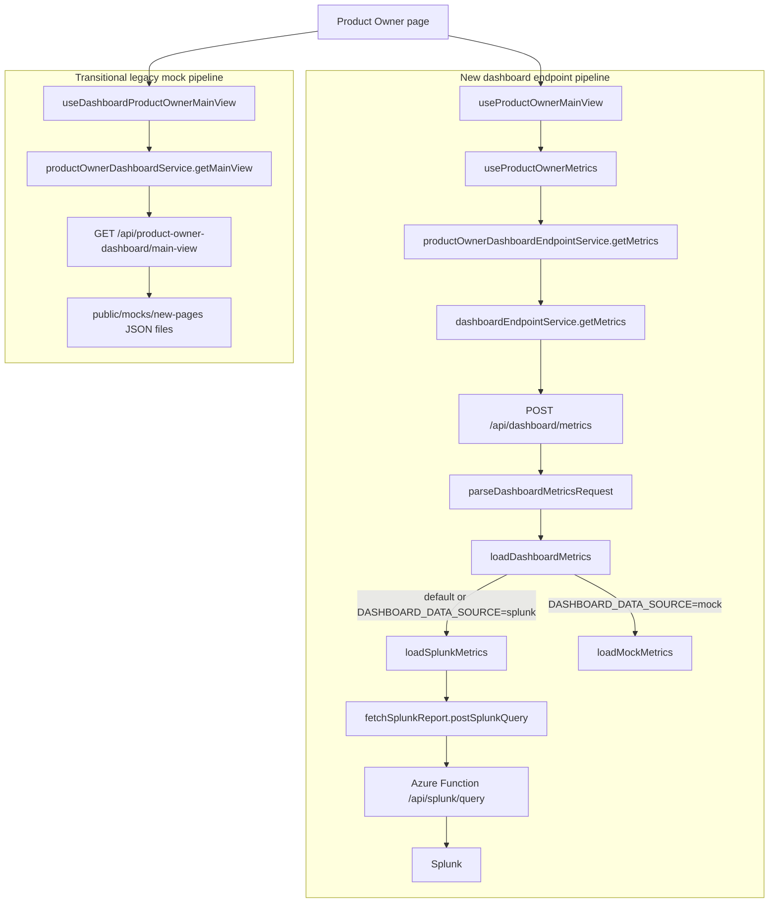

# Product Owner dashboard Splunk data flow

## Purpose

This document describes the Product Owner dashboard architecture introduced in
PR #17, with emphasis on the metrics path from the page to the external data
source.

The dashboard currently runs two data pipelines in parallel:

1. a new dashboard-endpoint pipeline intended for Splunk-backed data; and
2. a legacy main-view pipeline that still supplies mock data for sections not
   covered by the new endpoint contract.

The legacy mock pipeline is transitional and should be removed after the
Splunk-backed endpoints cover the complete Product Owner main view.

This document follows one representative new-endpoint path:
`useProductOwnerMainView` -> `useProductOwnerMetrics` -> `getMetrics` ->
`POST /api/dashboard/metrics` -> `loadSplunkMetrics`.

The timeseries path uses the same layers, but is outside this document's
detailed scope.

## Architecture overview



## Why there are two page-level pipelines

The [Product Owner page](../../app/home/product-owner-dashboard/page.tsx) reads
the selected period, business unit, and project from the shared dashboard
filter store. It then starts both of these requests:

```ts
const { metrics, adoption, quality } = useProductOwnerMainView({
  period,
  businessUnit,
  project,
});

const { mainViewData: mainView } = useDashboardProductOwnerMainView({
  period,
  businessUnit,
  project,
});
```

### New dashboard-endpoint pipeline

[`useProductOwnerMainView`](../../hooks/useProductOwnerDashboardEndpoints.ts)
composes three independent React Query resources:

- one metrics request through `useProductOwnerMetrics`;
- one Adoption and Engagement timeseries request; and
- one Experience and Response Quality timeseries request.

The new pipeline is responsible for the Product Experience Pulse metrics and
the two chart families. Its server-side data source can be either Splunk or the
endpoint-specific mock provider.

### Transitional legacy mock pipeline

[`useDashboardProductOwnerMainView`](../../hooks/useProductOwnerDashboard.ts)
calls
[`productOwnerDashboardService.getMainView`](../../lib/services/productOwnerDashboardService.ts),
which performs:

```text
GET /api/product-owner-dashboard/main-view
```

In local design mode, that route reads JSON fixtures from
[`public/mocks/new-pages`](../../public/mocks/new-pages). The page still uses
this response for data not yet covered by the new metrics and timeseries
contracts, including Feedback Summary, Feature Usage Evidence, and Trust and
Measurement Readiness. Channel Mix also remains local.

This second pipeline is temporary. Once the Splunk-backed endpoint contracts
cover these remaining sections, the legacy hook, service call, route dependency,
and duplicate page request should be removed.

There is also an endpoint-level mock branch inside the new pipeline:
`DASHBOARD_DATA_SOURCE=mock` routes metrics and timeseries requests to
[`productOwnerDemoSource.ts`](../../lib/server/dashboard/productOwnerDemoSource.ts).
That branch exists to support local fixture-backed development of the new DTO
contract. It is separate from the legacy `main-view` request, even though both
ultimately read local JSON data.

## Detailed metrics flow

### 1. Page composition

The [page](../../app/home/product-owner-dashboard/page.tsx) calls
`useProductOwnerMainView` with the current UI filters. The composition hook
starts metrics and timeseries queries independently, allowing each resource to
have its own React Query cache, loading state, and error state.

This document follows only the metrics resource.

### 2. React Query metrics hook

[`useProductOwnerMetrics`](../../hooks/useProductOwnerDashboardEndpoints.ts)
creates a query with:

- query key `["product-owner", "metrics", filters]`;
- query function
  `productOwnerDashboardEndpointService.getMetrics(filters)`; and
- window-focus refetching disabled.

Including the filters in the key gives every period, business-unit, and project
combination an independent cached result.

### 3. Product Owner endpoint service

[`getMetrics`](../../lib/services/productOwnerDashboardEndpointService.ts)
translates the page filters into the endpoint DTO:

- `7d`, `30d`, and `90d` become `last_7_days`, `last_30_days`, and
  `last_90_days`;
- business unit and project become arrays;
- timezone is fixed to `UTC`; and
- the request asks for the four Product Experience Pulse metric IDs.

The resulting request has this shape:

```ts
{
  dashboard: "product-owner",
  sections: ["product-experience-pulse"],
  metrics: [
    "session-query-volume",
    "api-error-rate",
    "end-to-end-latency-p95",
    "workflow-completion",
  ],
  filters: {
    timeRange: { type: "relative", value: "last_30_days" },
    businessUnits: ["all"],
    projects: ["all"],
    timezone: "UTC",
  },
  options: {
    includePending: true,
    includeCoverage: true,
  },
}
```

The service delegates transport to the shared dashboard client and then calls
`adaptProductOwnerMetrics` on the endpoint response.

The existing
[`adaptProductOwnerMetrics`](../../lib/dashboard/productOwnerEndpointAdapter.ts)
is the endpoint-DTO-to-UI-model boundary. In this connectivity stage, the
Splunk branch returns an empty `metrics` array, so there are no raw metric rows
to adapt. Meaningful metric adaptation can be completed only after the raw
Azure Function/Splunk response contract is known and the server produces
populated `MetricsResponseDto` rows.

This distinction is important:

```text
raw Azure Function/Splunk response
    -> MetricsResponseDto mapping          future work
    -> adaptProductOwnerMetrics
    -> Product Owner UI model
```

`adaptProductOwnerMetrics` does not parse the raw Splunk payload.

### 4. Shared browser transport

[`dashboardEndpointService.getMetrics`](../../lib/services/dashboardEndpointService.ts)
uses the shared Axios client to send:

```text
POST /api/dashboard/metrics
```

The request body is the typed `MetricsRequestDto`. The service returns the
typed `MetricsResponseDto` from the route without applying Product
Owner-specific presentation logic.

### 5. Next.js metrics route

[`app/api/dashboard/metrics/route.ts`](../../app/api/dashboard/metrics/route.ts)
is the browser-to-server boundary.

It:

1. reads the JSON request body;
2. passes it through `parseDashboardMetricsRequest`;
3. calls `loadDashboardMetrics`; and
4. serializes the resulting DTO as JSON.

Malformed request errors return HTTP 400. Known Splunk contract errors return
HTTP 501, unsupported environment errors return HTTP 500, and other upstream
or provider failures return HTTP 502.

Request validation is intentionally incomplete in this PR. The current parser
delegates to a pass-through cast in the mock provider so that local-demo
allowlists do not block the initial Splunk connectivity test. Restoring
environment-appropriate validation is follow-up work.

### 6. Server-side data-source selection

[`dashboardDataSource.ts`](../../lib/server/dashboard/dashboardDataSource.ts)
keeps source selection on the server:

| `DASHBOARD_DATA_SOURCE` | Metrics provider |
| --- | --- |
| unset, empty, or `splunk` | `loadSplunkMetrics` |
| `mock` | `loadMockMetrics` |
| any other value | error |

Splunk is therefore the default for the new metrics and timeseries endpoints.
The mock override is explicit.

This selector is independent from the older
`NEXT_PUBLIC_LOCAL_DESIGN_MODE` flag used by the legacy main-view pipeline.
Because the page currently starts both pipelines, the application can make a
Splunk-backed metrics request while also making a legacy mock-data request for
the uncovered sections.

### 7. `loadSplunkMetrics`

[`loadSplunkMetrics`](../../lib/server/dashboard/dashboardSplunkSource.ts) is
the current dashboard-specific Splunk boundary.

For this first connectivity stage it:

1. dynamically imports `splunkReportService` so Key Vault initialization does
   not affect the mock branch;
2. builds a fixed rolling 30-day interval ending at the current time;
3. executes the search string
   `| savedsearch consolidated_metric_final`;
4. receives the raw upstream response;
5. logs the complete raw value in formatted JSON; and
6. returns a valid metrics response envelope with an empty `metrics` array.

The raw logging statement is:

```ts
console.log(
  "[dashboard] Splunk metrics raw response:",
  JSON.stringify(raw, null, 2),
);
```

This is server-side logging. It appears in the Next.js server/runtime logs, not
in the browser console. Its purpose is to verify that the connection succeeds
and to inspect the actual response shape before implementing field mapping.

The request DTO's selected period, business units, projects, and timezone are
currently echoed in `meta.appliedFilters`, but they are not yet forwarded into
the upstream search. The actual query uses a fixed 30-day time window. This is
a connectivity test, not the final filtered data implementation.

Returning an empty metrics array also means the page renders its missing-metric
states even after a successful upstream call. A successful transport request
does not yet mean usable Product Owner values are displayed.

## Why `splunkReportService` calls an Azure Function

Despite its name,
[`splunkReportService.ts`](../../lib/services/splunkReportService.ts) does not
open a direct connection from the Next.js application to Splunk.

`postSplunkQuery` sends an HTTP POST request to:

```text
{SPLUNK_SERVICE_BASE_URL}/api/splunk/query?code={SPLUNK_FUNCTION_SECRET}
```

The body contains:

```json
{
  "SEARCH_QUERY": "| savedsearch consolidated_metric_final",
  "START_TIME": "<ISO timestamp>",
  "END_TIME": "<ISO timestamp>"
}
```

The `/api/...` route shape and `code` query parameter represent the
function-key-protected Azure Function contract used by this application. The
Next.js server authenticates to that intermediary with
`SPLUNK_FUNCTION_SECRET`; it does not hold or use Splunk connection details in
this path.

The end-to-end integration boundary is therefore:

```text
browser
  -> Next.js dashboard API route
  -> splunkReportService
  -> Azure Function
  -> Splunk
  -> Azure Function response
  -> Next.js server log and temporary empty metrics DTO
  -> browser
```

The Azure Function owns the downstream Splunk interaction and forwards the
result back to the Next.js application. The Azure Function implementation is
not part of this repository, so details of its internal Splunk client,
authentication, and response transformation cannot be verified here. The
application-side contract only proves that it calls the Function endpoint and
receives its HTTP response.

## Configuration and secret loading

`splunkReportService` loads and caches:

- the Azure Function base URL; and
- the Azure Function access secret.

The source depends on `ENVIRONMENT`:

| `ENVIRONMENT` | Configuration source |
| --- | --- |
| exactly `local` | `SPLUNK_SERVICE_BASE_URL` and `SPLUNK_FUNCTION_SECRET` environment variables |
| any other value, including unset | Azure Key Vault |

For non-local execution, the service requests:

- `kv-data-integrity-splunk-service-base-url`; and
- `kv-data-integrity-splunk-function-secret`.

Missing configuration fails explicitly. Values are cached in memory after the
first successful load.

`DASHBOARD_DATA_SOURCE` and `ENVIRONMENT` solve different problems:

- `DASHBOARD_DATA_SOURCE` selects the dashboard provider (`splunk` or `mock`);
- `ENVIRONMENT` determines where the Azure Function configuration is loaded
  from inside `splunkReportService`.

For a local Splunk connectivity test, both settings must be coherent:

```text
ENVIRONMENT=local
DASHBOARD_DATA_SOURCE=splunk
SPLUNK_SERVICE_BASE_URL=<Azure Function base URL>
SPLUNK_FUNCTION_SECRET=<Azure Function key>
```

## Response and error flow

On success:

1. the Azure Function response is returned by `postSplunkQuery`;
2. `loadSplunkMetrics` logs it;
3. `loadSplunkMetrics` returns metadata plus `metrics: []`;
4. the API route returns HTTP 200;
5. the browser service passes the DTO to `adaptProductOwnerMetrics`; and
6. React Query stores the result and the page shows missing-data states.

On an Azure Function, network, configuration, or Key Vault failure:

1. `postSplunkQuery` logs and rethrows the original error;
2. `loadSplunkMetrics` allows the error to propagate;
3. the metrics route returns HTTP 502; and
4. Axios and React Query expose the request as an error to the page.

There is no silent fallback from Splunk to mock data in the new dashboard
endpoint pipeline.

## Current limitations and follow-up work

This PR establishes the call chain and connectivity boundary. It does not
complete the production data contract.

Required follow-up work includes:

1. confirm the exact raw response returned by the Azure Function;
2. confirm the approved saved search and its expected parameters;
3. forward the selected time range, business units, projects, and timezone
   rather than using a fixed 30-day interval;
4. map the raw response into populated `MetricsResponseDto` rows;
5. complete the meaningful Product Owner metrics adaptation after the raw and
   endpoint contracts are stable;
6. replace full raw-payload logging with appropriately scoped operational
   logging once the response shape is confirmed;
7. restore real request validation using production filter values;
8. implement the equivalent timeseries path;
9. migrate Feedback Summary, Feature Usage Evidence, Trust and Measurement
   Readiness, Channel Mix, and any remaining drawer data to the new contracts;
   and
10. remove the legacy `useDashboardProductOwnerMainView` mock-data pipeline
    after feature parity is reached.

## Final target

After the migration, the Product Owner page should have one coherent endpoint
architecture:

```text
page
  -> Product Owner React Query hooks
  -> Product Owner endpoint service
  -> shared dashboard HTTP service
  -> Next.js dashboard routes
  -> dashboard data-source boundary
  -> Azure Function
  -> Splunk
```

Mock providers may remain available for deliberate local UI development, but
the page should no longer need a second legacy main-view request to fill gaps
in the Splunk-backed contract.
