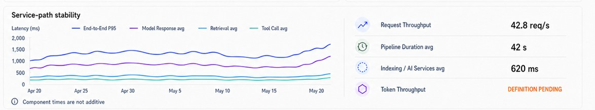
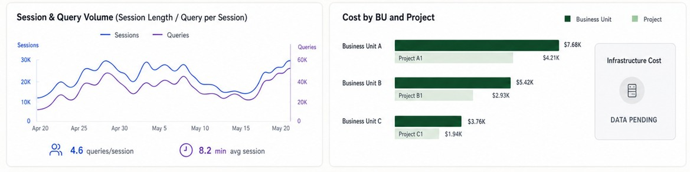

# Dashboard Panel

## Overview

The Dashboard Panel is a shared structural wrapper for dashboard content. It defines the panel shell, optional title treatment, and the single-vs-segmented region layout without prescribing the business logic or internal content of the widgets placed inside it.

This component keeps the dashboard visual family consistent while allowing each region to contain a chart, list, summary card, or custom composition.

## Purpose

Use the Dashboard Panel when a dashboard section needs a consistent outer container and a predictable split pattern. It is intentionally generic and does not own metric calculations, chart logic, or domain-specific display rules.

## Supported patterns

### 1. Single-region panel

A single-region panel is used for a standalone content area. The component renders a single container with an optional whole-panel title.

### 2. Segmented panel

A segmented panel is used when a section needs multiple peer regions. Regions are defined through an ordered `sections` array, and each region can optionally display a section title.

The segmented template supports:

- two-region layouts
- three-region layouts
- four-region or larger layouts
- equal-status peer regions without a primary/supporting hierarchy

## Component contract

```tsx
<DashboardPanel
  template="single" | "segmented"
  title="Optional panel title"
  sections={[{ id: "left", title: "Optional section title" }]}
>
  {children}
</DashboardPanel>
```

### Props

- `template`: either `"single"` or `"segmented"`
- `title`: optional whole-panel heading
- `sections`: optional array of `{ id, title }` entries used by segmented layouts
- `children`: content rendered inside the panel or its regions
- `className`: optional custom styling hook

## Behavior

- Renders the outer panel border, rounded corners, padding, and background shell.
- Renders a single region when `template="single"`.
- Renders ordered children into the matching section order when `template="segmented"`.
- Shows a divider only between adjacent segmented regions.
- Supports either a whole-panel title or section-level titles, but not both unless explicitly needed.
- Warns when the number of children does not match the number of provided sections.

## Design principles

- The panel is a structural container, not a business widget.
- It should preserve the dashboard’s generic shell styling across feature areas.
- Child components remain responsible for their own composition, hierarchy, and content.
- Region order and region count are driven by data rather than hard-coded logic.

## Visual references

These examples show the panel patterns in the dashboard design references.





## Implementation example

```tsx
import DashboardPanel from '@/components/shared/dashboard/DashboardPanel';

export default function DashboardPanelExample() {
  return (
    <>
      <DashboardPanel template="single" title="Shared Panel - single region">
        <div className="text-sm text-slate-700">
          This is a generic shared panel container used as a structural test.
        </div>
      </DashboardPanel>

      <DashboardPanel
        template="segmented"
        title="Shared Panel - segmented"
        sections={[
          { id: 'left', title: 'Primary' },
          { id: 'middle', title: 'Secondary' },
          { id: 'right', title: 'Tertiary' },
        ]}
      >
        <div className="text-sm text-slate-700">Region one</div>
        <div className="text-sm text-slate-700">Region two</div>
        <div className="text-sm text-slate-700">Region three</div>
      </DashboardPanel>
    </>
  );
}
```

## Out of scope

- Metric calculations and business rules
- API logic and data fetching
- Domain-specific widget behavior
- Chart-specific or list-specific rendering logic
- Responsive behavior beyond the approved dashboard layout scope
