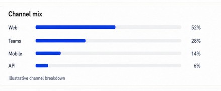

# Horizontal Bar List

## Overview

The Horizontal Bar List is a compact structural component for displaying an ordered set of category percentages or values as horizontal bars. It is meant for dashboard sections that need a quick category comparison without introducing metric logic or business interpretation.

The component is intentionally generic: it accepts data as a list of `{ label, value }` items and renders them as a label, a proportional bar, and the displayed value.

## Purpose

Use the Horizontal Bar List for compact comparisons such as:

- channel mix
- distribution summaries
- adoption share by category
- any other ordered list where a proportional bar helps compare relative weight

It is a presentational component only. It does not calculate totals, normalize values, or determine meaning from the supplied inputs.

## Component contract

```tsx
const values = [
  { label: 'Web', value: 52 },
  { label: 'Teams', value: 28 },
  { label: 'Mobile', value: 14 },
  { label: 'API', value: 6 },
];

<HorizontalBarList values={values} />;
```

### Props

- `values`: ordered array of objects with:
  - `label`: the text shown at the start of the row
  - `value`: the numeric value used to size the bar and show the percent label

## Behavior

- Renders each item as a row with label, bar, and value.
- Attempts to keep the component height stable and consistent across rows.
- Flows rows top-to-bottom into a second column when the row count exceeds the approved single-column height.
- Keeps the layout to a maximum of two columns.
- Preserves the reading order and DOM order of the supplied list.
- Uses CSS Grid rather than float-based layout.

## Design principles

- The component is a display shell, not a metric engine.
- It does not assign category meaning or interpret the values.
- It stays compact and readable inside shared dashboard panels.
- It helps create visual consistency across different dashboard sections.

## Visual reference



## Implementation example

```tsx
import HorizontalBarList from '@/components/shared/charts/HorizontalBarList';

const channelMixValues = [
  { label: 'Web', value: 52 },
  { label: 'Teams', value: 28 },
  { label: 'Mobile', value: 14 },
  { label: 'API', value: 6 },
];

export default function HorizontalBarListExample() {
  return <HorizontalBarList values={channelMixValues} />;
}
```

This component is used in the operations team dashboard for channel mix summaries.

## Component location

- Shared component: [components/shared/charts/HorizontalBarList.tsx](../../../components/shared/charts/HorizontalBarList.tsx)

## Out of scope

- Icons and warning states
- Metric calculations and normalization
- API calls, telemetry, and data fetching
- Overflow beyond the approved two-column behavior
- Panel shell styling and dashboard placement
