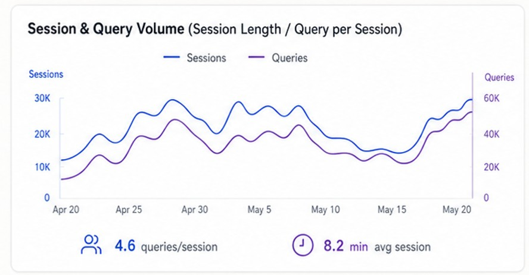
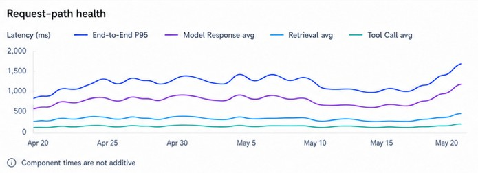

# Line Chart

## Overview

The Line Chart is a reusable dashboard chart component for presenting continuous trends across time or another ordered axis. It renders one or more line series, supports optional axis configuration, and can include a supporting stats area beneath the plot.

This component is a presentation layer: it renders the supplied data and the configured chart structure, but it does not calculate, aggregate, normalize, or interpret values for the business.

## Purpose

Use the Line Chart for trend-based dashboard views such as:

- request-path health
- session and query volume
- latency and throughput trends
- performance comparisons across series

The component is intentionally generic and can be used across product, operations, and executive dashboard views.

## Component contract

```tsx
const series = [
  {
    id: 'sessions',
    label: 'Sessions',
    color: '#3b82f6',
    yAxis: 'left',
    points: [
      { x: 'Apr 20', y: 12000 },
      { x: 'Apr 21', y: 15000 },
      { x: 'Apr 22', y: 18000 },
    ],
  },
  {
    id: 'queries',
    label: 'Queries',
    color: '#8b5cf6',
    yAxis: 'right',
    points: [
      { x: 'Apr 20', y: 10000 },
      { x: 'Apr 21', y: 16000 },
      { x: 'Apr 22', y: 19000 },
    ],
  },
];

<DashboardLineChart
  title="Session & Query Volume"
  description="Session Length / Query per session"
  series={series}
  axes={[
    { id: 'left', tickFormatter: (value) => `${Math.round(value / 1000)}K` },
    { id: 'right', tickFormatter: (value) => `${Math.round(value / 1000)}K` },
  ]}
/>;
```

### Props

- `title`: optional chart title
- `description`: optional supporting chart description
- `series`: ordered array of line series objects
- `axes`: optional axis config for left/right Y axes
- `supportingStats`: optional list of supporting stats below the chart
- `height`: chart height
- `showGrid`: whether to render grid lines
- `className`: optional styling hook

## Behavior

- Renders each series as its own line with its own label, color, and Y-axis assignment.
- Accepts multiple series and multiple Y axes when configured.
- Builds the legend using each series label and color.
- Renders optional supporting stats beneath the chart when supplied.
- Preserves the supplied point order for readable chart output.

## Design principles

- The chart renders supplied data; it does not derive business conclusions.
- Series identity, legend label, axis placement, and visual color are explicit inputs.
- Supporting stats remain a separate compositional unit beneath the plot.
- The component should be reusable across dashboard categories without hard-coded metric meaning.

## Visual references

These examples show the approved line-chart presentation patterns used in the UI system.





## Implementation example

```tsx
import DashboardLineChart from '@/components/shared/dashboard/DashboardLineChart';

const series = [
  {
    id: 'sessions',
    label: 'Sessions',
    color: '#3b82f6',
    yAxis: 'left',
    points: [
      { x: 'Apr 20', y: 15000 },
      { x: 'Apr 21', y: 14000 },
      { x: 'Apr 22', y: 18000 },
    ],
  },
  {
    id: 'queries',
    label: 'Queries',
    color: '#8b5cf6',
    yAxis: 'right',
    points: [
      { x: 'Apr 20', y: 12000 },
      { x: 'Apr 21', y: 16000 },
      { x: 'Apr 22', y: 19000 },
    ],
  },
];

export default function LineChartExample() {
  return (
    <DashboardLineChart
      description="Session Length / Query per session"
      height={320}
      series={series}
      axes={[
        { id: 'left', tickFormatter: (value) => `${Math.round(value / 1000)}K` },
        { id: 'right', tickFormatter: (value) => `${Math.round(value / 1000)}K` },
      ]}
    />
  );
}
```

## Component location

- Shared component: [components/shared/dashboard/DashboardLineChart.tsx](../../../components/shared/dashboard/DashboardLineChart.tsx)

## Out of scope

- Data calculation and metric interpretation
- Telemetry or API contracts
- Business threshold logic or health classification
- Supporting stats layout internals
- Any hard-coded metric assumptions or chart-specific domain rules
