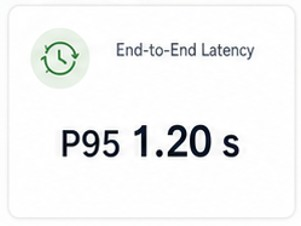

# Metric Card

## Overview

The Metric Card is a compact dashboard summary component for presenting a single metric in a fixed visual hierarchy. It is designed for quick scanning and can be used across dashboard sections where one short result needs to be highlighted with a small amount of supporting context.

The component owns the card shell, the icon-and-title header, and the fixed primary/supporting content structure. It does not assign meaning to the metric or compute the value.

## Purpose

Use the Metric Card when a dashboard needs a compact summary card for things like:

- latency
- volume
- user satisfaction
- quality or reliability signal
- readiness or trend summary

It is intentionally generic and should be reused for many metric types without embedding business logic in the component.

## Component contract

```tsx
<MetricCard
  icon={<ArrowSync24Regular />}
  title="End-to-End Latency"
  primaryContent={
    <div>
      P95 <span>1.20 s</span>
    </div>
  }
  supportingContent={<span>Healthy response profile</span>}
/>
```

### Props

- `icon`: leading icon displayed with the title
- `title`: short identifying label for the metric
- `primaryContent`: the main result or statement rendered prominently
- `supportingContent`: optional supporting text or visualization rendered below the primary content
- `className`: optional styling hook for variant or theme adjustments

## Behavior

- Renders a card surface with consistent padding and spacing.
- Places the icon and title in the header area.
- Renders primary content as the dominant value block.
- Renders supporting content beneath the primary content only when supplied.
- Allows both text and visualization-based supporting content while preserving one fixed slot.
- Keeps the card reusable without prescribing metric semantics.

## Design principles

- The card is a structured summary shell rather than a data service.
- It supports optional supporting content without changing the overall card anatomy.
- The caller supplies the meaning and the data, while the component supplies the placement and layout.
- It should remain readable without relying only on color or icon meaning.

## Visual references

These examples show the approved metric-card patterns used in the dashboard system.




## Implementation example

```tsx
import { MetricCard } from '@/components/shared/dashboard/MetricCard';
import { ThumbLike24Regular } from '@fluentui/react-icons';

export default function MetricCardExample() {
  return (
    <MetricCard
      icon={<ThumbLike24Regular className="text-green-600" />}
      title="User Feedback"
      primaryContent={
        <div className="text-xl font-semibold text-neutral-950">
          84% <span className="text-2xl font-normal">positive</span>
        </div>
      }
      supportingContent={<span className="text-xs text-neutral-500">84% positive • 16% negative</span>}
    />
  );
}
```

## Component location

- Shared component: [components/shared/dashboard/MetricCard.tsx](../../../components/shared/dashboard/MetricCard.tsx)

## Out of scope

- Metric calculations and value processing
- API calls and data fetching
- Interpretation of thresholds, health, or quality outcomes
- Layout logic for a child chart or list passed through `supportingContent`
- Arbitrary free-form content layout through `children`
