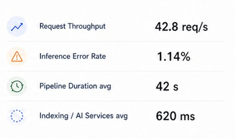
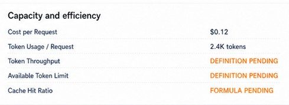
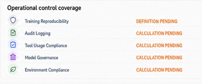

# Metric List

## Overview

The Metric List is a compact list component for rendering a group of labeled metrics in a single, ordered column. It is designed for dashboard sections that need quick comparisons or status summaries without adding panel logic or business interpretation.

Each row follows the same structure: an optional icon, a label, and an end-aligned value.

## Purpose

Use the Metric List when a dashboard section needs a readable vertical stack of metric rows such as:

- operational performance metrics
- throughput and latency summaries
- readiness indicators
- service or platform quality measures

This component is purely structural. It presents the supplied data in a consistent list layout and does not decide what a value means.

## Component contract

```tsx
const items = [
  {
    id: 'request-throughput',
    icon: <DataTrending24Regular />,
    label: 'Request Throughput',
    value: '42.8 req/s',
  },
  {
    id: 'token-throughput',
    label: 'Token Throughput',
    value: 'Definition pending',
  },
];

<MetricList items={items} />;
```

### Props

- `items`: ordered array of objects with:
  - `id`: stable React key
  - `icon`: optional visual element before the label
  - `label`: text shown on the left
  - `value`: displayed on the right, as text or ReactNode
- `className`: optional styling hook

## Behavior

- Renders rows in the supplied order.
- Renders the optional icon when present and omits it cleanly when absent.
- Keeps the label and value aligned in a consistent row layout.
- Uses separators between rows when needed by the selected visual treatment.
- Accepts text and JSX content in `value` without imposing business meaning.

## Design principles

- The component should remain simple and reusable across many dashboard contexts.
- It should not own section titles, panel boundaries, or chart logic.
- It should preserve a predictable label/value rhythm and readable spacing.
- The caller makes the metric semantics explicit; the component only presents them.

## Visual references

These examples illustrate the compact metric-list layouts used in dashboard views.







## Implementation example

```tsx
import MetricList from '@/components/shared/dashboard/MetricList';
import { DataTrending24Regular, WarningRegular } from '@fluentui/react-icons';

const items = [
  {
    id: 'request-throughput',
    icon: <DataTrending24Regular fontSize={18} />,
    label: 'Request Throughput',
    value: '42.8 req/s',
  },
  {
    id: 'inference-error',
    icon: <WarningRegular primaryFill="red" fontSize={18} />,
    label: 'Inference Error Rate',
    value: '1.14%',
  },
];

export default function MetricListExample() {
  return <MetricList items={items} />;
}
```

## Component location

- Shared component: [components/shared/dashboard/MetricList.tsx](../../../components/shared/dashboard/MetricList.tsx)

## Out of scope

- Panel shell behavior and surrounding section titles
- Metric calculations and API data processing
- Status interpretation or threshold logic
- Arbitrary child layouts beyond the fixed labeled-value row pattern
