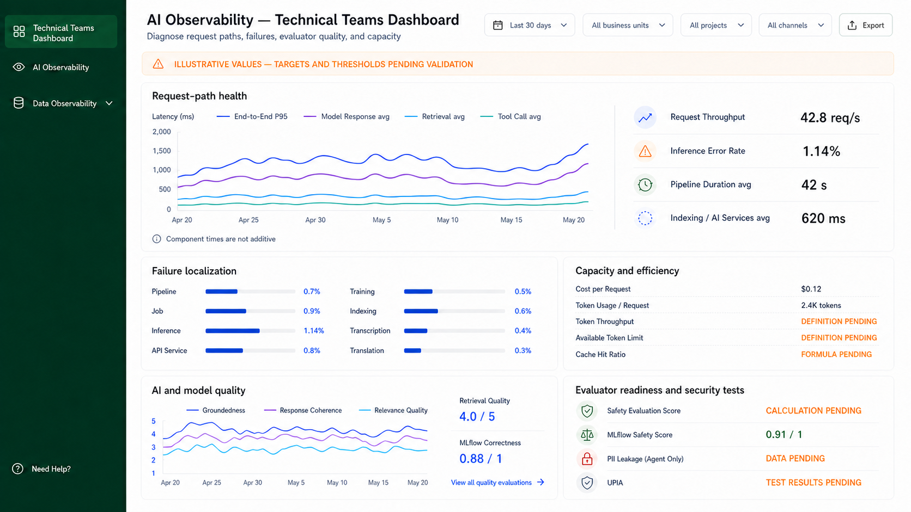

# Pending State Value

## Overview

The Pending State Value is a compact inline component for rendering an approved
unavailable-data state where a metric value would normally appear. It replaces
the value itself, inside a metric row, list, or card, and keeps the surrounding
row geometry unchanged.

This component handles one fixed responsibility: displaying a documented pending
or unavailable state as readable text. It does not calculate values, decide when
a metric is pending, or manage the surrounding row, list, or panel.

## Purpose

Use the Pending State Value wherever a metric cannot show a number because its
definition, formula, data, calculation, test results, or filter attribution are
not yet approved. Typical placements are:

- a `MetricList` row value, with or without a leading icon
- a supporting value beside a chart
- a metric card's primary content

The dashboard documentation requires that missing telemetry is never rendered as
zero, blank, or a healthy value. This component exists so that requirement has a
single, consistent implementation instead of ad-hoc strings at each call site.

## Component contract

```tsx
<PendingStateValue state="definition" />
```

### Props

- `state`: which approved unavailable state to render. One of `data`,
  `definition`, `formula`, `calculation`, `test-results`, `scale`, `threshold`,
  `filter-breakdown`, or `evaluator-coverage`.
- `srDescription`: optional additional explanation announced to assistive
  technology, for cases where the short label alone is not sufficient context.
- `className`: optional styling hook for additional layout adjustments.

### State labels

The component owns the mapping from `state` to visible text. Callers pass the
state, not the string, so that wording stays consistent everywhere it appears.

| `state` | Rendered text |
| --- | --- |
| `data` | `DATA PENDING` |
| `definition` | `DEFINITION PENDING` |
| `formula` | `FORMULA PENDING` |
| `calculation` | `CALCULATION PENDING` |
| `test-results` | `TEST RESULTS PENDING` |
| `scale` | `SCALE PENDING` |
| `threshold` | `THRESHOLD PENDING` |
| `filter-breakdown` | `FILTER BREAKDOWN UNAVAILABLE` |
| `evaluator-coverage` | `EVALUATOR COVERAGE PENDING` |

The labels are not produced by appending a suffix to the state name.
`filter-breakdown` ends in `UNAVAILABLE` rather than `PENDING`, so the mapping is
explicit per state.

## Behavior

- Renders uppercase text using the warning content color token.
- Occupies the value position of its row without changing that row's height.
- Accepts no numeric, empty-string, or zero fallback. There is no prop that
  degrades a pending state into a value.
- Exposes the state as text, so a screen reader announces the same information a
  sighted reader sees.
- Applies no icon by default. A leading icon, when a design calls for one,
  belongs to the containing row, not to this component.

## Design principles

- Text carries the meaning; color reinforces it. The uppercase label is legible
  with color removed, satisfying the rule that status is never signalled by color
  alone.
- The component is deliberately not a badge, pill, or chip. In the approved
  designs a pending state sits in the same visual position as the value it
  replaces, so a heavier treatment would make unavailable data more prominent
  than available data.
- The state vocabulary is closed. A caller that needs a state not in the table
  should have that state added here after it is documented, rather than passing
  free text.
- The component makes no claim about when the data will arrive. It reports a
  present-tense state only.

## Relationship to neighbouring components

- `StatusCallout` renders an icon badge with a title stacked above its content
  and is used where a readiness item stands alone. Pending State Value is the
  inline value used inside a row.
- `DataPendingCard` fills an entire panel region where a chart or grid would
  otherwise render. Pending State Value never fills a region.

Both of those components may receive a Pending State Value as their content.

## Visual reference

Every pending state in the approved Technical Teams main view uses this
treatment: the three `Capacity and efficiency` rows and the three
`Evaluator readiness and security tests` rows.



## Implementation example

```tsx
import MetricList from '@/components/shared/dashboard/MetricList';
import PendingStateValue from '@/components/shared/dashboard/PendingStateValue';

export default function CapacityAndEfficiency() {
  return (
    <MetricList
      items={[
        { id: 'cost-per-request', label: 'Cost per Request', value: '$0.12' },
        { id: 'token-usage', label: 'Token Usage / Request', value: '2.4K tokens' },
        {
          id: 'token-throughput',
          label: 'Token Throughput',
          value: <PendingStateValue state="definition" />,
        },
        {
          id: 'available-token-limit',
          label: 'Available Token Limit',
          value: <PendingStateValue state="definition" />,
        },
        {
          id: 'cache-hit-ratio',
          label: 'Cache Hit Ratio',
          value: <PendingStateValue state="formula" />,
        },
      ]}
    />
  );
}
```

## Component location

- Planned shared component:
  `components/shared/dashboard/PendingStateValue.tsx`

## Out of scope

- Deciding whether a metric is pending; the caller supplies that
- Metric calculation, aggregation, or data fetching
- Explaining why a state is pending, or when it will be resolved
- Thresholds, targets, and favorable or unfavorable interpretation
- Panel, row, and list layout
- Any fallback that substitutes a number for an unavailable value
