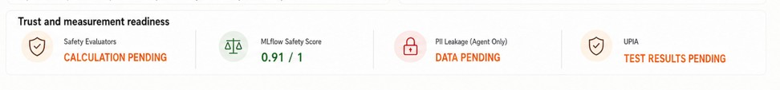

# Status Callout

## Overview

The Status Callout is a compact, reusable dashboard component for presenting a short status summary in a dense layout. It is designed for placement inside a larger dashboard region or panel, where a clear title and a concise primary result are more important than a full card treatment.

This component handles a fixed layout: an icon, a title, and a primary content result. It does not manage the surrounding panel, grid, or chart logic.

## Purpose

Use the Status Callout when a view needs a compact status summary such as:

- evaluation readiness
- safety score
- leakage risk state
- pending or successful operational result

It is intentionally generic and should not encode business rules about whether the value is good, bad, or pending. The caller provides the rendered content and the meaning behind it.

## Component contract

```tsx
<StatusCallout
  icon={<ShieldCheckmark24Regular />}
  title="Safety Evaluators"
  primaryContent="CALCULATION PENDING"
  variant="warning"
/>
```

### Props

- `icon`: the leading visual element
- `title`: short identifying label
- `primaryContent`: the prominent result or status value
- `variant`: visual tone for the icon background and icon color (`warning`, `success`, or `danger`)
- `className`: optional styling hook for additional layout adjustments

## Behavior

- Renders a circular icon badge on the left.
- Renders a stacked title and primary content block on the right.
- Accepts both plain text and React renderable nodes for `primaryContent`.
- Keeps the layout compact enough for peer regions and panel-based dashboard compositions.
- Uses color and icon styling only as part of the presentation layer, not as business logic.

## Design principles

- The component is a compact status summary, not a panel wrapper.
- It preserves a consistent visual structure across all dashboard surfaces.
- Title and primary content remain readable without relying solely on icon meaning.
- The caller owns the semantic interpretation of the result.

## Visual reference

This status callout pattern is used in dashboard areas where a compact readiness or result indicator is needed.



## Implementation example

```tsx
import StatusCallout from '@/components/shared/dashboard/StatusCallout';
import { ShieldCheckmark24Regular } from '@fluentui/react-icons';

export default function StatusCalloutExample() {
  return (
    <StatusCallout
      icon={<ShieldCheckmark24Regular />}
      title="Safety Evaluators"
      primaryContent="CALCULATION PENDING"
      variant="warning"
    />
  );
}
```

This pattern is used in the executive dashboard as part of a compact readiness row.

## Component location

- Shared component: [components/shared/dashboard/StatusCallout.tsx](../../../components/shared/dashboard/StatusCallout.tsx)

## Out of scope

- Panel and grid shell behavior
- Metric calculation or data fetching
- Domain-specific status meanings or thresholds
- Chart rendering and arbitrary child composition
- Layout decisions for the surrounding dashboard section
